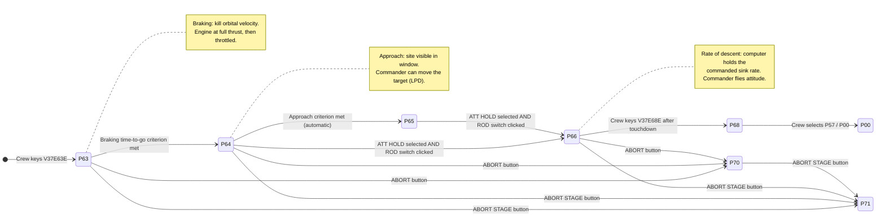

# Luminary099: Powered Descent

A guided tour of how the Apollo 11 Lunar Module computer flew the landing, from powered descent initiation to touchdown. These pages are written for people who are new to the AGC source code. They use modern diagrams to show what the 1969 assembly does.

> **How to trust these pages.** Every step cites the source as `FILE.agc:LINE` and links to the line in [`Luminary099/`](../../../Luminary099/). Anything that comes from mission history rather than from the code is marked **Historical**. Anything that is a reasonable reading but not stated outright in the code is marked **Inferred**.

## Contents

| Page | Answers the question |
|---|---|
| This page | What happens during descent, and who does it? |
| [Event chains](event-chains.md) | What happens, in order, when a key is pressed, a timer fires, or an alarm trips? |
| [P63: Braking phase](programs/p63.md) | How the landing starts, and how the engine is lit |
| [P64: Approach phase](programs/p64.md) | How the computer flies toward the site, and how the commander moves it |
| [P66: Rate of descent](programs/p66.md) | How the final semi-manual descent works |
| [P68: Landing confirmation](programs/p68.md) | What the computer does once the LM is on the surface |
| [P70 / P71: Descent aborts](programs/p70-p71.md) | How the ABORT buttons take over from the landing |

## The descent at a glance

Program numbers (P63, P64 and so on) are **major modes**. The current one is shown in the PROG window on the DSKY, the crew's keyboard and display. The landing passes through them in this order:

| Transition | What triggers it in the code | Source |
|---|---|---|
| → P63 | V37 program-change request; `FCADRMM1` table entry `P63LM` | [FRESH_START_AND_RESTART.agc:1071](../../../Luminary099/FRESH_START_AND_RESTART.agc#L1071) |
| P63 → P64 | `EXTLOGIC` sees `TENDBRAK + TTF/8` turn positive, advances `WCHPHASE`, next pass runs `STARTP64` | [LUNAR_LANDING_GUIDANCE_EQUATIONS.agc:692](../../../Luminary099/LUNAR_LANDING_GUIDANCE_EQUATIONS.agc#L692), [:260](../../../Luminary099/LUNAR_LANDING_GUIDANCE_EQUATIONS.agc#L260) |
| P64 → P65 | Same `EXTLOGIC` test using `TENDAPPR`; runs `P65START` | [LUNAR_LANDING_GUIDANCE_EQUATIONS.agc:252](../../../Luminary099/LUNAR_LANDING_GUIDANCE_EQUATIONS.agc#L252) |
| → P66 | `GUILDEN` (routine R13): attitude-hold discrete present **and** `RODCOUNT` ≠ 0 | [LUNAR_LANDING_GUIDANCE_EQUATIONS.agc:194-208](../../../Luminary099/LUNAR_LANDING_GUIDANCE_EQUATIONS.agc#L194-L208) |
| → P68 | V37 request; `FCADRMM1` entry `LANDJUNK` | [FRESH_START_AND_RESTART.agc:1070](../../../Luminary099/FRESH_START_AND_RESTART.agc#L1070) |
| → P70 / P71 | `R10,R11` task polls channel 30 for the ABORT / ABORT STAGE buttons | [P70-P71.agc:83-99](../../../Luminary099/P70-P71.agc#L83-L99) |

There is also a **P67** (fully manual throttle), selected whenever the throttle is switched out of AUTO. It is covered briefly in the [P66 page](programs/p66.md).

**Historical:** "High gate" and "low gate" are the mission names for the P63→P64 and P64→P66 switch points. The code never uses those words; it only tests time-to-go (`TTF/8`) against pad-loaded criteria.

## The cast

| Code | Role | Runs as | Source |
|---|---|---|---|
| `P63LM` | P63 entry: initial setup, ignition-time search | Job, priority 13 | [THE_LUNAR_LANDING.agc:40](../../../Luminary099/THE_LUNAR_LANDING.agc#L40) |
| `BURNBABY` | Master ignition routine: countdown, ullage, engine on | Job, then a chain of Waitlist tasks | [BURN_BABY_BURN--MASTER_IGNITION_ROUTINE.agc:159](../../../Luminary099/BURN_BABY_BURN--MASTER_IGNITION_ROUTINE.agc#L159) |
| `READACCS` | Reads the accelerometers every 2 s and schedules SERVICER | Waitlist task | [SERVICER.agc:79](../../../Luminary099/SERVICER.agc#L79) |
| `SERVICER` | Navigation: updates position and velocity, blends in landing radar data | Job, priority 20 | [SERVICER.agc:175](../../../Luminary099/SERVICER.agc#L175) |
| `LUNLAND` | Landing guidance: where should the thrust point, and how hard? | Runs inside the SERVICER job | [LUNAR_LANDING_GUIDANCE_EQUATIONS.agc:117](../../../Luminary099/LUNAR_LANDING_GUIDANCE_EQUATIONS.agc#L117) |
| `GUILDEN` (R13) | Watches the cockpit mode switches each pass and selects P66 / P67 | Inside LUNLAND | [LUNAR_LANDING_GUIDANCE_EQUATIONS.agc:134](../../../Luminary099/LUNAR_LANDING_GUIDANCE_EQUATIONS.agc#L134) |
| `THROTTLE` | Turns the commanded thrust into throttle pulses for the descent engine | Subroutine | [THROTTLE_CONTROL_ROUTINES.agc:37](../../../Luminary099/THROTTLE_CONTROL_ROUTINES.agc#L37) |
| `FINDCDUW` | Turns the commanded thrust direction into attitude commands for the autopilot (DAP) | Subroutine | [FINDCDUW--GUIDAP_INTERFACE.agc:118](../../../Luminary099/FINDCDUW--GUIDAP_INTERFACE.agc#L118) |
| `R10,R11` | Drives the cockpit altitude and velocity meters 4× per second, and polls the abort buttons | Waitlist task | [P70-P71.agc:36](../../../Luminary099/P70-P71.agc#L36) |
| `PITFALL` / `REDESMON` | Read the commander's hand controller to move the landing site (LPD) | Interrupt / Waitlist task | [LUNAR_LANDING_GUIDANCE_EQUATIONS.agc:1130](../../../Luminary099/LUNAR_LANDING_GUIDANCE_EQUATIONS.agc#L1130) |
| `RODCOMP` | P66 rate-of-descent throttle law | Job, priority 22 | [LUNAR_LANDING_GUIDANCE_EQUATIONS.agc:948](../../../Luminary099/LUNAR_LANDING_GUIDANCE_EQUATIONS.agc#L948) |
| `LANDJUNK` | P68: record the landing site, set the surface flags | Job | [THE_LUNAR_LANDING.agc:286](../../../Luminary099/THE_LUNAR_LANDING.agc#L286) |
| `ABRTJASK` / `GOABORT` | P70/P71 takeover and abort guidance setup | Interrupt context / Job | [P70-P71.agc:133](../../../Luminary099/P70-P71.agc#L133), [:220](../../../Luminary099/P70-P71.agc#L220) |
| `BAILOUT1` / `ENEMA` | Program alarm (1201/1202) and software restart | Restart code | [ALARM_AND_ABORT.agc:189](../../../Luminary099/ALARM_AND_ABORT.agc#L189), [FRESH_START_AND_RESTART.agc:281](../../../Luminary099/FRESH_START_AND_RESTART.agc#L281) |

## How to read AGC code: a short glossary

You need these terms for every diagram on these pages.

**Executive and jobs.** The Executive ([EXECUTIVE.agc](../../../Luminary099/EXECUTIVE.agc)) is a tiny priority scheduler. A **job** is a unit of longer-running work with a priority. Higher priority runs first. Jobs are requested with `NOVAC` or `FINDVAC` ([EXECUTIVE.agc:37](../../../Luminary099/EXECUTIVE.agc#L37), [:52](../../../Luminary099/EXECUTIVE.agc#L52)).

**Core sets and VAC areas.** Every job needs a **core set**, a small block of memory that holds its registers and priority. Jobs that use the interpreter (below) also need a **VAC area** for scratch storage. There are only 8 core sets and 5 VAC areas. If they run out, the result is alarm **1202** (no core sets) or **1201** (no VAC areas). See the [1202 event chain](event-chains.md#3-the-1202-alarm-overload-restart-recover).

**Waitlist and tasks.** The Waitlist ([WAITLIST.agc](../../../Luminary099/WAITLIST.agc)) runs short **tasks** at a set time, driven by a hardware timer interrupt. Tasks must be quick. Anything long, a task hands off by scheduling a job. `WAITLIST`, `TWIDDLE`, `VARDELAY` and `LONGCALL` all schedule tasks. A task ends with `TASKOVER`.

**Interrupts.** Hardware events such as a keypress (`KEYRUPT1`), a hand-controller input (`RUPT10`) or a timer stop the current work briefly. The handler ends with `RESUME`.

**Interpreter.** Much of the guidance math is written in an "interpretive" language: virtual vector and matrix instructions such as `VLOAD`, `DOT` and `UNIT`, run by [INTERPRETER.agc](../../../Luminary099/INTERPRETER.agc). `TC INTPRET` switches into it and `EXIT` switches back to native code.

**Restart protection (`PHASCHNG`).** Important routines record checkpoints in **phase tables** by calling `PHASCHNG` ([PHASE_TABLE_MAINTENANCE.agc:228](../../../Luminary099/PHASE_TABLE_MAINTENANCE.agc#L228)). Work is divided into numbered **restart groups**: for example group 5 is the SERVICER cycle, group 3 is guidance and group 4 is the burn sequence. After a software restart, only the work recorded in the phase tables is relaunched. This is what saved the Apollo 11 landing.

**Major mode (`MODREG`).** The erasable register that holds the current program number shown in the PROG window. `NEWMODEX` changes it, and `CHECKMM` tests it.

**DSKY verbs and nouns.** The crew talks to the computer as *Verb Noun* pairs. A verb is an action and a noun is a piece of data. Examples:
- **V37** means "change program", so V37E63E means "Verb 37, Enter, 63, Enter", i.e. start P63.
- **V06 N63** means "display decimal: noun 63" (altitude-rate, altitude and so on).
- A **flashing** verb/noun is a question to the crew. **PRO** (proceed) means yes. **V34** means terminate. **ENTER** means recycle.

**Flags.** Single bits in "flagwords" ([FLAGWORD_ASSIGNMENTS.agc](../../../Luminary099/FLAGWORD_ASSIGNMENTS.agc)), set with `SET` / `UPFLAG` and cleared with `CLEAR` / `DOWNFLAG`. For example `MUNFLAG` means "lunar descent navigation", `SURFFLAG` means "on the surface", and `LETABORT` means "aborts allowed".

**Channels.** Hardware I/O ports. Channel 30 and channel 31 bits carry cockpit switches; note they are **inverted**, so 0 means "signal present" ([INPUT_OUTPUT_CHANNEL_BIT_DESCRIPTIONS.agc:143-144](../../../Luminary099/INPUT_OUTPUT_CHANNEL_BIT_DESCRIPTIONS.agc#L143-L144)). Channel 14 sends throttle pulses, and channel 11 bit 13 turns the engine on.

**Time units.** Delays are in **centiseconds**. `2SECS` is `DEC 200` ([FIXED_FIXED_CONSTANT_POOL.agc:117](../../../Luminary099/FIXED_FIXED_CONSTANT_POOL.agc#L117)).

**Comments with personality.** The programmers left jokes ("OFF TO SEE THE WIZARD", "PLEASE CRANK THE SILLY THING AROUND", "NUMERO MYSTERIOSO"). They're real, and they often mark important places.
