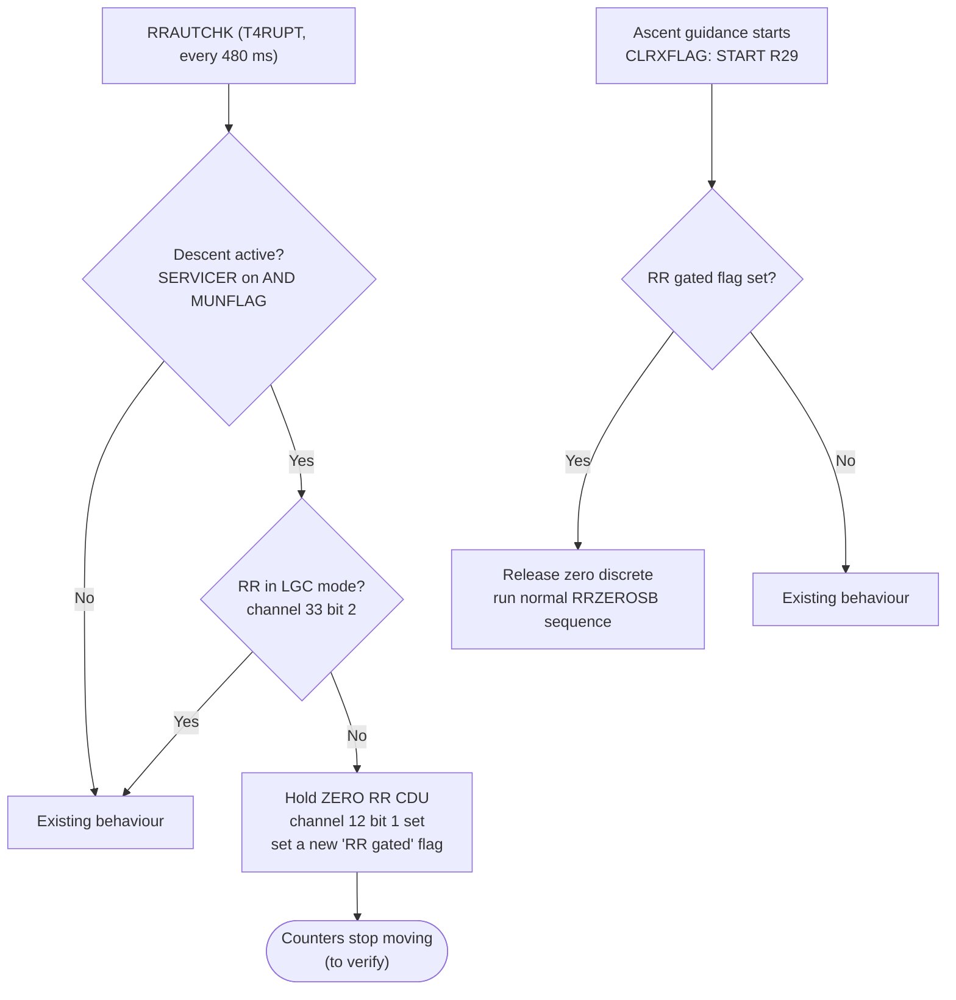
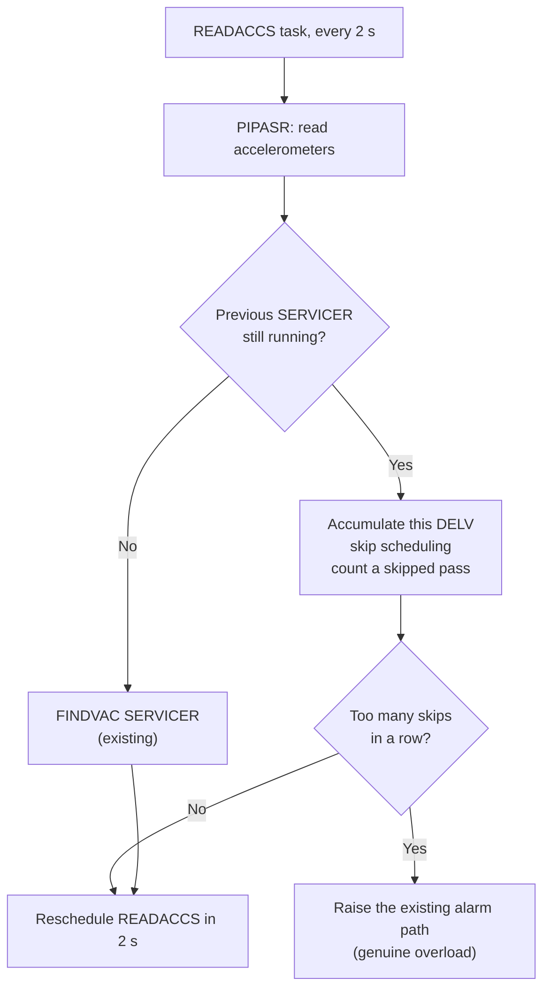
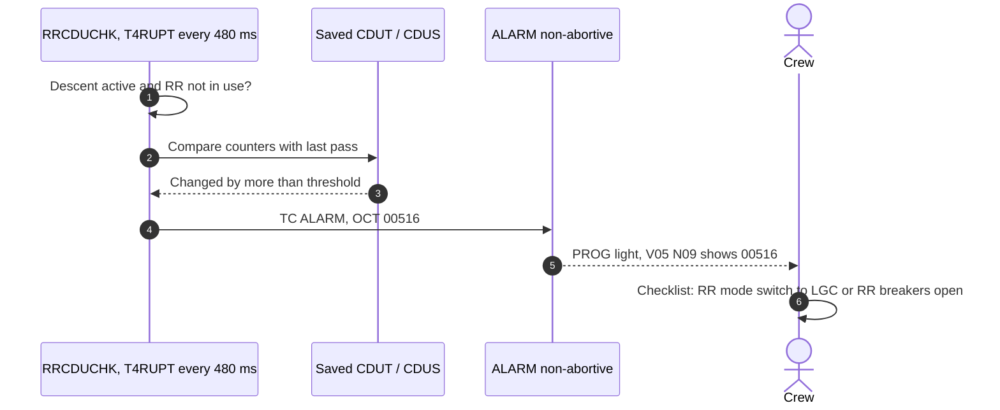

# Enhancement Proposal: Stop the Rendezvous Radar Draining the CPU During Descent

[← Descent overview](../README.md) · Related: [The 1202 alarm event chain](../event-chains.md#3-the-1202-alarm-overload-restart-recover)

| | |
|---|---|
| **Status** | Proposal: options to consider. No code changed yet. |
| **Target** | `Luminary099/` in this fork (Apollo 11 LM software) |
| **Goal** | During descent, the computer should spend its time only on what descent needs. Rendezvous radar capability must still be available if the crew aborts. |
| **Later phases** | (2) Patch the source and assemble it with yaYUL. (3) Fly the descent in Virtual AGC: reproduce the 1202s, then show the fix. See [Next phases](#next-phases-code-and-simulation). |

> **How to trust this page.** Code claims cite `FILE.agc:LINE`. History claims cite a source under [Sources](#sources). Anything marked **Inferred** or **To verify** is a reasonable reading that hasn't been proven yet.

---

## 1. The problem in one paragraph

On Apollo 11 the crew left the rendezvous radar (RR) powered up and its mode switch in **SLEW**, so the radar would be warm if an abort meant tracking the command module again. A phase mismatch between two 800 Hz power supplies made the RR's angle converters (CDUs) send the computer up to **6,400 counter pulses per second per axis**. Every pulse forced the CPU to execute an involuntary counter increment, using up a memory cycle. Together they consumed **about 13–15% of CPU time** [E][G]. Descent guidance had only about 10–15% headroom, less once the crew called up the V16 N68 monitor [E]. SERVICER fell behind, jobs piled up, and the Executive ran out of core sets: **1202**, then **1201** [E]. The restart design saved the landing ([event chain 3](../event-chains.md#3-the-1202-alarm-overload-restart-recover)). Nobody in Houston or the cockpit knew *why* it was happening.

## 2. The human cost of uncertainty

| GET | | |
|---|---|---|
| 102:38:26 | Armstrong | "Program Alarm." |
| 102:38:30 | Armstrong | "It's a 1202." |
| 102:38:42 | Armstrong | "Give us a reading on the 1202 Program Alarm." |
| 102:38:53 | Duke (CAPCOM) | "We're Go on that alarm." |
| 102:42:19 | Aldrin / Duke | "1201" … "Roger. 1201 alarm … Same type. We're Go." |

Source: [ALSJ11].

- **27 seconds** passed between the first alarm and the GO, during the most critical phase of the mission.
- **A recent simulation had gone the other way.** Shortly before launch, simulation supervisor Richard Koos's team set up a 1201 alarm in a simulation. Flight controllers Steve Bales and Jack Garman called an abort. They were told it wasn't mission-critical. Gene Kranz then ordered the team to list every possible alarm [G][KOOS]. Garman's handwritten list was "under a piece of plastic … stuck it under the glass on the console" [G]. That list, and Bales trusting it, is the only reason the call was GO. Garman: *"if Steve had called an abort, they might well have aborted"* [G].
- **The crew was flying blind.** Aldrin: *"I was very much in the dark when this came up"* [ALSJ11]. Armstrong said that in simulations they were "usually spring-loaded to the abort position" [ALSJ11].
- **MIT didn't know either.** *"At MIT, where we realized that something mysterious was draining time from the computer, we were barely breathing"* [E]. The cause *"wasn't known for another day or so, and a day is a long time when you're landing on the Moon"* [G].

**Design takeaway.** A fix should make the overload *not happen*. If it happens anyway, the computer should *say why* in terms the crew and Houston can act on.

## 3. What the code already does, and why that wasn't enough

The natural idea is "make descent stop evaluating radar data it doesn't need". It turns out **Luminary099 already does that**:

| Already gated during descent | Source |
|---|---|
| P63's `FLAGORGY` kills the rendezvous programs P20 and P25 | [THE_LUNAR_LANDING.agc:64](../../../../Luminary099/THE_LUNAR_LANDING.agc#L64) |
| `R29` (point the RR at the command module during powered flight) stays off. Only ascent guidance turns it on: "START R29 IN ASCENT PHASE" | [ASCENT_GUIDANCE.agc:349](../../../../Luminary099/ASCENT_GUIDANCE.agc#L349), [SERVICER.agc:788-801](../../../../Luminary099/SERVICER.agc#L788-L801) |
| `R25` RR gimbal-limit monitor is skipped when SERVICER and `MUNFLAG` are on: "YES. DON'T DO R25" | [T4RUPT_PROGRAM.agc:1248-1255](../../../../Luminary099/T4RUPT_PROGRAM.agc#L1248-L1255) |

The drain came from **below** the software:

**Key point:** no program has to read a counter for its increment to cost CPU time. "Ignore the data" can't help. The enhancement has to either **stop the pulses at the source**, **absorb an unexpected drain**, or **detect it and say so**.

**CPU budget during descent**

| Item | Share of CPU | Source |
|---|---|---|
| Headroom during braking, before landing-radar lock | "over 15%" | [E] |
| Headroom after landing-radar lock | about 13% | [E] |
| Headroom with V16 N68 monitor added | "10% or less" | [E] |
| RR counter drain (`TLOSS`) | 13–15% (Grumman measured max 13.36%) | [E] |

---

## 4. Options

### Option 1: Gate the radar at the source (hold the RR CDUs zeroed during descent)

**Idea.** During descent, if the RR isn't in LGC mode (meaning no program can be using it), hold the RR CDU zero discrete so the counters stop moving. Release it when ascent starts, either a normal ascent or an abort.

**Precedent.** This is essentially what MIT did for Apollo 12 (Luminary 1B, Luminary 116): *"We added logic to LUMINARY to check the rendezvous radar mode, and if it was not in LGC"* the RR counters are zeroed (change request PCR 848) [E][VAGC].

**Where it fits in Luminary099**

| Hook | Source | Change |
|---|---|---|
| RR mode check, every 480 ms | `RRAUTCHK` [T4RUPT_PROGRAM.agc:1112](../../../../Luminary099/T4RUPT_PROGRAM.agc#L1112) | Add the descent branch |
| Existing zero-discrete use: set for 20 ms, then cleared | `RRZEROSB` [P20-P25.agc:1684-1697](../../../../Luminary099/P20-P25.agc#L1684-L1697) | Reuse; hold instead of pulse |
| Descent test already in use | `RRGIMON` [T4RUPT_PROGRAM.agc:1248-1255](../../../../Luminary099/T4RUPT_PROGRAM.agc#L1248-L1255) | Copy the same SERVICER + `MUNFLAG` test |
| Release point on ascent or abort | `CLRXFLAG` [ASCENT_GUIDANCE.agc:349](../../../../Luminary099/ASCENT_GUIDANCE.agc#L349) | Release, then re-zero |
| Abort paths reach ascent guidance through `AVGEXIT = ATMAG` | [P70-P71.agc:331-333](../../../../Luminary099/P70-P71.agc#L331-L333) | No change; covered by the release point |

**Benefits.** It removes the root cause, needs no crew action, and has flight precedent.

**Trade-offs and risks**
- **After an abort, the RR needs re-zeroing before it is useful.** `RRZEROSB` waits 1,000 cs (10 s) ([P20-P25.agc:1698-1699](../../../../Luminary099/P20-P25.agc#L1698-L1699)). R29 only designates the antenna, so a 10 s delay early in ascent is probably acceptable. **To verify.**
- **Don't break the cockpit cross-pointer.** Descent reuses the RR **error counter** enable (channel 12 **bit 2**) and the CDU drive bits to move the forward/lateral velocity needles ([LANDING_ANALOG_DISPLAYS.agc:179-181](../../../../Luminary099/LANDING_ANALOG_DISPLAYS.agc#L179-L181), [:497-500](../../../../Luminary099/LANDING_ANALOG_DISPLAYS.agc#L497-L500)). The proposal touches only **bit 1** (zero). **To verify** that holding bit 1 doesn't disturb the error-counter output path.
- **Software restarts.** `STARTSB2` clears radar mode bits and leaves "RR LOCKON ENABLE ALONE" ([FRESH_START_AND_RESTART.agc:437-449](../../../../Luminary099/FRESH_START_AND_RESTART.agc#L437-L449)). The gating must survive or be re-applied after a restart, and the release point must still fire after an abort's `ENEMA` restart.

**Open hardware question (blocking).** Does *holding* the zero discrete actually stop the pulse train, or does it only reset the counters once? The comments say only "TURN ON ZERO RR CDU" / "ZERO RR CDU; CDU'S GIVE RRADAR INFORMATION FOR LM" ([INPUT_OUTPUT_CHANNEL_BIT_DESCRIPTIONS.agc:75](../../../../Luminary099/INPUT_OUTPUT_CHANNEL_BIT_DESCRIPTIONS.agc#L75)). Answer it from Virtual AGC hardware notes, or by finding what Luminary 116 actually did.

---

### Option 2: Absorb any drain gracefully (drop a SERVICER pass instead of queuing another)

**Idea.** If `READACCS` fires while the previous SERVICER job is still running, **skip one navigation pass** instead of scheduling another SERVICER job. The job queue never fills, so a CPU drain from *any* cause degrades guidance slightly instead of triggering 1202 restarts.

**Precedent.** In time for Apollo 13, MIT engineer Allan Klumpp *"devised a fix in which an occasional whole SERVICER job would be dropped to catch up"* (Luminary 131, PCR 1013) [E][VAGC]. A variable-period SERVICER, which was immune to high drain, was tested but never flew [E].

| Hook | Source |
|---|---|
| `READACCS` schedules SERVICER every pass | [SERVICER.agc:79-100](../../../../Luminary099/SERVICER.agc#L79-L100) |
| Job request via `FINDVAC` (where 1201/1202 originate) | [EXECUTIVE.agc:52](../../../../Luminary099/EXECUTIVE.agc#L52), [:146-147](../../../../Luminary099/EXECUTIVE.agc#L146-L147), [:207-208](../../../../Luminary099/EXECUTIVE.agc#L207-L208) |
| SERVICER restart protection (group 5) | [SERVICER.agc:175-179](../../../../Luminary099/SERVICER.agc#L175-L179) |

**Benefits.** It's cause-agnostic: it would also cover the V16 N68 load, unexpected radar behaviour, or anything else.

**Trade-offs and risks**
- **Velocity must not be lost.** A skipped pass's accelerometer reading must be carried into the next navigation update, or navigation errors grow. **Most delicate part.**
- **Guidance and throttle update less often during a skip.** Check against the throttle code's assumption that the guidance period is "EITHER 1 OR 2 SECONDS" ([THROTTLE_CONTROL_ROUTINES.agc:131-158](../../../../Luminary099/THROTTLE_CONTROL_ROUTINES.agc#L131-L158)).
- **It hides the drain.** Without Option 3 it treats the symptom and the cause stays invisible.

---

### Option 3: Name the cause (a specific, non-abort radar alarm)

**Idea.** During descent, if the RR angle counters (`CDUT` / `CDUS`) change between monitor passes while no program is using the radar, raise a **new, clearly documented, non-abort alarm**, for example **00516 "RR COUNTING IN DESCENT, SET RR TO LGC"**. 00516 and 00517 are unused in the radar alarm group ([ASSEMBLY_AND_OPERATION_INFORMATION.agc:926-942](../../../../Luminary099/ASSEMBLY_AND_OPERATION_INFORMATION.agc#L926-L942)).

This is the option that addresses [section 2](#2-the-human-cost-of-uncertainty): Houston and the crew get the **cause and the remedy**, minutes before any overload, not a generic Executive overflow code.

| Hook | Source |
|---|---|
| Existing RR monitor chain in T4RUPT | `RRCDUCHK` [T4RUPT_PROGRAM.agc:1178](../../../../Luminary099/T4RUPT_PROGRAM.agc#L1178) |
| Existing non-abort radar alarm pattern (`TC ALARM` / `OCT 00515`) | [T4RUPT_PROGRAM.agc:1205-1206](../../../../Luminary099/T4RUPT_PROGRAM.agc#L1205-L1206) |
| Alarm table to extend | [ASSEMBLY_AND_OPERATION_INFORMATION.agc:926-942](../../../../Luminary099/ASSEMBLY_AND_OPERATION_INFORMATION.agc#L926-L942) |

**Benefits.** Small, low-risk code. It turns an unknown into a checklist item, and it pairs naturally with Option 1 (detect first, or detect if gating fails).

**Trade-offs and risks**
- **The threshold must ignore normal noise** and the brief motion when the RR is zeroed. `RRZEROSB` sets the "zeroing in process" bit, which can be used as a mask.
- **It's another alarm in a busy phase.** That's mitigated by making it unique, documented and non-abortive.

---

### Option 4: Procedure only (no code change)

**Idea.** Keep the RR circuit breakers open during descent and close them only if an abort happens. On the Apollo 12 descent, Pete Conrad said: *"Rendezvous Radar CB, for the 99th time, they're both open"* [ALSJ12]. During Apollo 11 itself, Houston told the crew *"we do not want the rendezvous radar on during the ascent … There's a good 15 percent duty cycle"* [SPACELOG].

**Benefits.** Nothing to code or test in software.

**Trade-offs.** It depends on the crew getting it right every time. After an abort the radar has to warm up from cold. It does nothing for the next unknown drain.

---

## 5. Comparison

| | Opt 1: Gate at source | Opt 2: Drop a pass | Opt 3: Name the cause | Opt 4: Procedure |
|---|---|---|---|---|
| Stops the RR drain | **Yes** (to verify) | No | No | **Yes** |
| Survives *other* drains | No | **Yes** | No | No |
| Removes uncertainty | Partly | No (hides it) | **Yes** | Partly |
| Abort radar readiness | ~10 s re-zero | Unaffected | Unaffected | Cold start |
| Code risk | Medium (T4RUPT, restarts) | **High** (navigation) | Low | None |
| Historical precedent | Apollo 12 (PCR 848) | Apollo 13 (PCR 1013) | None found | Apollo 12 |
| Easy to show in Virtual AGC | Yes | Yes | Yes | n/a |

## 6. Recommendation

1. **Option 3 first.** It's the smallest change, low risk, and proves we can see the drain in simulation. It also becomes the measuring stick for the other options.
2. **Then Option 1.** It fixes the root cause, once the hardware question about holding the zero discrete is answered.
3. **Option 2 as a stretch goal.** It's the most robust, but the riskiest to navigation. Do it only once the simulation harness can measure navigation error.

**Out of scope, deliberately:**
- Landing radar processing and its altitude/velocity updates.
- The R10 cross-pointer use of the RR error counter.
- The P70/P71 abort sequencing, apart from the single release point in Option 1.

These are the parts of descent the crew actually depends on.

---

## Next phases: code and simulation

**Phase 2: patch and assemble**
- [ ] Get yaYUL (the Virtual AGC assembler) building locally, and confirm that **unmodified** `Luminary099/MAIN.agc` assembles to a binary matching the published Luminary099 rope. This is the baseline.
- [ ] Implement the chosen option on a feature branch. Keep changes in as few `.agc` files as possible, each marked with a `# FORK:` comment for easy diffing.
- [ ] Re-assemble, and record the memory used. Fixed memory was nearly full in 1969, so check the free words in the banks we touch.

**Phase 3: observe the original issue, then the fix (Virtual AGC)**
- [ ] Run yaAGC with the Luminary099 rope plus a DSKY, and drive a descent scenario: P63 → P64 → P66.
- [ ] **Inject the RR drain.** yaAGC peripherals talk to the CPU over a socket protocol that can deliver counter-increment requests. A small script could send about 12,800 RR CDU increments per second. **To verify** that the protocol supports this at that rate.
- [ ] **Baseline run:** confirm the 1202/1201 alarms reproduce, ideally including the V16 N68 sensitivity Aldrin noticed.
- [ ] **Fixed run:** with the patched rope, show the outcome for each option tested: no alarms (Option 1), alarm 00516 before any overload (Option 3), or no restarts with skipped passes logged (Option 2).
- [ ] Capture the measurements: alarm times, restart count, idle-time or duty-cycle estimate, and navigation error for Option 2.

---

## Sources

- **[E]** Don Eyles, "Tales from the Lunar Module Guidance Computer," AAS 04-064 (2004). https://www.doneyles.com/LM/Tales.html
- **[G]** Jack Garman, NASA JSC Oral History, 27 March 2001. https://web.archive.org/web/2019/https://historycollection.jsc.nasa.gov/JSCHistoryPortal/history/oral_histories/GarmanJR/GarmanJR_3-27-01.htm
- **[ALSJ11]** Apollo Lunar Surface Journal, Apollo 11 landing. https://apollojournals.org/alsj/a11/a11.landing.html
- **[ALSJ12]** Apollo Lunar Surface Journal, Apollo 12 landing. https://apollojournals.org/alsj/a12/a12.landing.html
- **[SPACELOG]** Apollo 11 air-to-ground transcript (RR switch discussion). https://apollo11.spacelog.org/05:01:40:45/05:01:43:44
- **[VAGC]** Virtual AGC, Luminary versions. https://www.ibiblio.org/apollo/Luminary.html
- **[KOOS]** Monash Lens, "Koos control: the man who made the Apollo 11 moon landing possible" (secondary). https://lens.monash.edu/@science/2019/07/17/1375837/koos-control-the-man-who-made-the-apollo-11-moon-landing-possible
- **[A14]** ALSJ, "Apollo 14 Abort Discrete": a related case where software was made to ignore a faulty input during descent. https://apollojournals.org/alsj/a14/a14AbortDiscrete.html

**Accounts differ on two points:**
- Some accounts (Hamilton; a 2009 MIT piece) call the root cause a "checklist error". Eyles argues it was an interface-specification gap: the two 800 Hz supplies were required to be frequency-locked but not phase-synchronized [E].
- Some secondary sources describe "radar jobs" filling the queue. Eyles' and Garman's accounts of hardware cycle-stealing match the code analysis in section 3.
