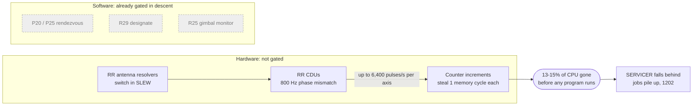
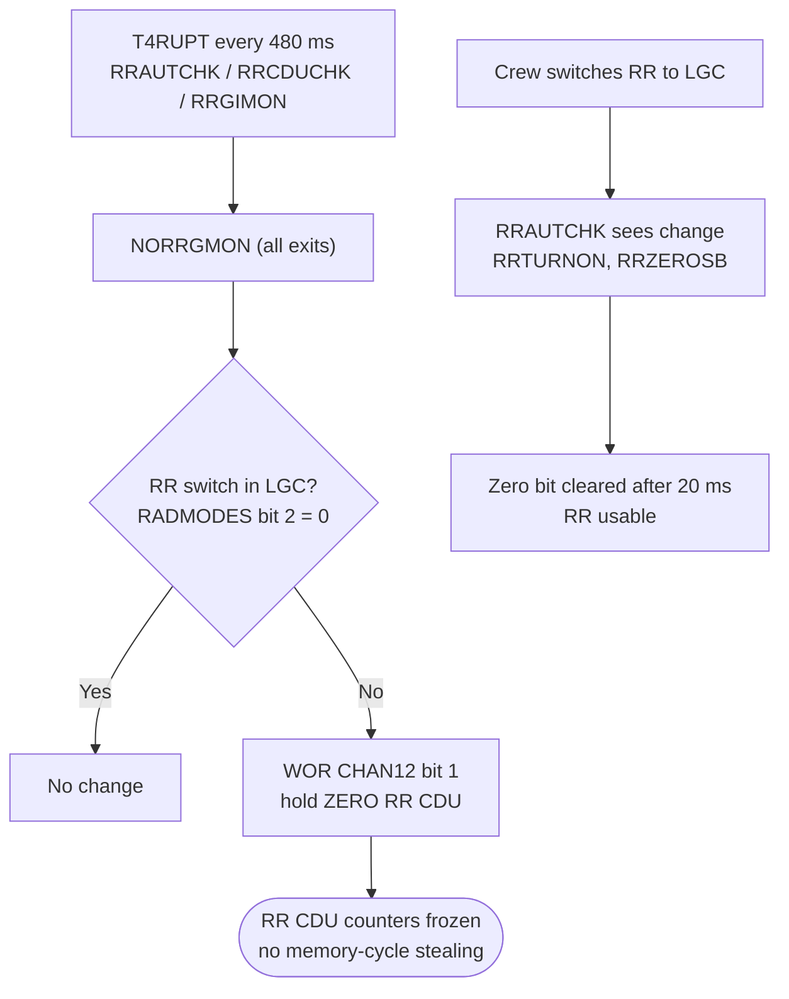
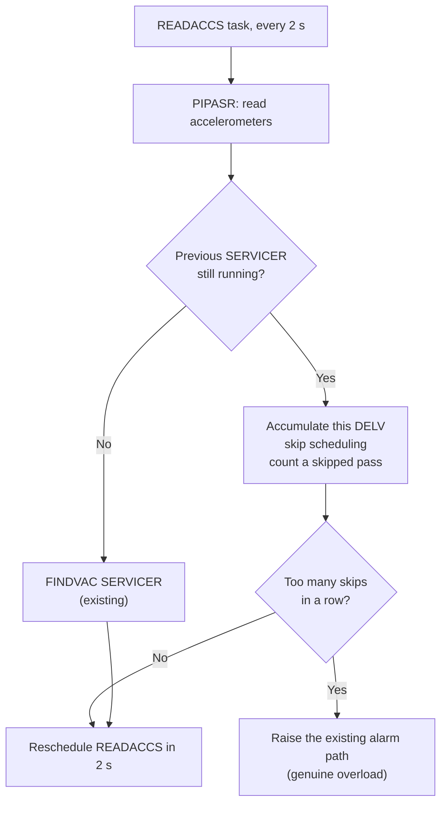
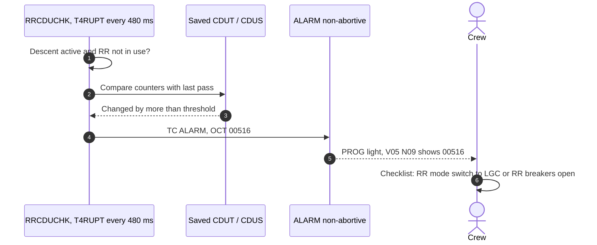

# Enhancement Proposal: Stop the Rendezvous Radar Draining the CPU During Descent

[← Descent overview](../README.md) · Related: [The 1202 alarm event chain](../event-chains.md#3-the-1202-alarm-overload-restart-recover)

| | |
|---|---|
| **Status** | Proposal: options to consider. No code changed yet. Updated with the actual post-Apollo 11 fixes found in later Luminary versions ([section 4](#4-what-mit-actually-did-after-apollo-11)). |
| **Target** | `Luminary099/` in this fork (Apollo 11 LM software) |
| **Goal** | During descent, the computer should spend its time only on what descent needs. Rendezvous radar capability must still be available if the crew aborts. |
| **Later phases** | (2) Patch the source and assemble it with yaYUL. (3) Fly the descent in Virtual AGC: reproduce the 1202s, then show the fix. See [Next phases](#next-phases-code-and-simulation). |

> **How to trust this page.** Code claims cite `FILE.agc:LINE`. History claims cite a source under [Sources](#sources). Anything marked **Inferred** or **To verify** is a reasonable reading that hasn't been proven yet.

---

## 1. The problem in one paragraph

On Apollo 11 the crew left the rendezvous radar (RR) powered up and its mode switch in **SLEW**, so the radar would be warm if an abort meant tracking the command module again. A phase mismatch between two 800 Hz power supplies made the RR's angle converters (CDUs) send the computer up to **6,400 counter pulses per second per axis**. Every pulse forced the CPU to execute an involuntary counter increment, using up a memory cycle. Together they consumed **about 13–15% of CPU time** [E][G]. Descent guidance had only about 10–15% headroom, less once the crew called up the V16 N68 monitor [E]. SERVICER fell behind, jobs piled up, and the Executive ran out of core sets: **1202**, then **1201** [E]. The restart design saved the landing ([event chain 3](../event-chains.md#3-the-1202-alarm-overload-restart-recover)). Nobody in Houston or the cockpit knew *why* it was happening.

## 2. The human cost of uncertainty

| GET | | |
|---|---|---|
| 102:38:26 | Armstrong | "Program Alarm." |
| 102:38:30 | Armstrong | "It's a 1202." |
| 102:38:42 | Armstrong | "Give us a reading on the 1202 Program Alarm." |
| 102:38:53 | Duke (CAPCOM) | "We're Go on that alarm." |
| 102:42:19 | Aldrin / Duke | "1201" … "Roger. 1201 alarm … Same type. We're Go." |

Source: [ALSJ11].

- **27 seconds** passed between the first alarm and the GO, during the most critical phase of the mission.
- **A recent simulation had gone the other way.** Shortly before launch, simulation supervisor Richard Koos's team set up a 1201 alarm in a simulation. Flight controllers Steve Bales and Jack Garman called an abort. They were told it wasn't mission-critical. Gene Kranz then ordered the team to list every possible alarm [G][KOOS]. Garman's handwritten list was "under a piece of plastic … stuck it under the glass on the console" [G]. That list, and Bales trusting it, is the only reason the call was GO. Garman: *"if Steve had called an abort, they might well have aborted"* [G].
- **The crew was flying blind.** Aldrin: *"I was very much in the dark when this came up"* [ALSJ11]. Armstrong said that in simulations they were "usually spring-loaded to the abort position" [ALSJ11].
- **MIT didn't know either.** *"At MIT, where we realized that something mysterious was draining time from the computer, we were barely breathing"* [E]. The cause *"wasn't known for another day or so, and a day is a long time when you're landing on the Moon"* [G].

**Design takeaway.** A fix should make the overload *not happen*. If it happens anyway, the computer should *say why* in terms the crew and Houston can act on.

## 3. What the code already does, and why that wasn't enough

The natural idea is "make descent stop evaluating radar data it doesn't need". It turns out **Luminary099 already does that**:

| Already gated during descent | Source |
|---|---|
| P63's `FLAGORGY` kills the rendezvous programs P20 and P25 | [THE_LUNAR_LANDING.agc:64](../../../../Luminary099/THE_LUNAR_LANDING.agc#L64) |
| `R29` (point the RR at the command module during powered flight) stays off. Only ascent guidance turns it on: "START R29 IN ASCENT PHASE" | [ASCENT_GUIDANCE.agc:349](../../../../Luminary099/ASCENT_GUIDANCE.agc#L349), [SERVICER.agc:788-801](../../../../Luminary099/SERVICER.agc#L788-L801) |
| `R25` RR gimbal-limit monitor is skipped when SERVICER and `MUNFLAG` are on: "YES. DON'T DO R25" | [T4RUPT_PROGRAM.agc:1248-1255](../../../../Luminary099/T4RUPT_PROGRAM.agc#L1248-L1255) |

The drain came from **below** the software:



**Key point:** no program has to read a counter for its increment to cost CPU time. "Ignore the data" can't help. The enhancement has to either **stop the pulses at the source**, **absorb an unexpected drain**, or **detect it and say so**.

**CPU budget during descent**

| Item | Share of CPU | Source |
|---|---|---|
| Headroom during braking, before landing-radar lock | "over 15%" | [E] |
| Headroom after landing-radar lock | about 13% | [E] |
| Headroom with V16 N68 monitor added | "10% or less" | [E] |
| RR counter drain (`TLOSS`) | 13–15% (Grumman measured max 13.36%) | [E] |

---

## 4. What MIT actually did after Apollo 11

Virtual AGC has transcribed the LM software for every later landing, so we can see the real fixes in code, not just in memoirs. For how those sources were obtained and how far to trust each one, see [Source reliability](#source-reliability-of-the-later-versions).

| Mission (software) | Change | What it does |
|---|---|---|
| **Apollo 12** (Luminary 116) | **PCR 848: hold the RR CDUs zeroed if the RR switch isn't in LGC** | 8 instructions at the exit of the 480 ms radar monitor (below) |
| | Alarm 00515 suppressed while the RR is being zeroed | Stops the held zero causing false "RR CDU fail" alarms. `RRCDUCHK` masks `13,7,2` instead of bit 7 only |
| | 1201/1202 renamed 31201/31202 | The Executive logic is unchanged; the `3xxxx` prefix marks "this alarm caused a software restart" |
| **Apollo 13** (LM131 rev 1, the build that flew) | **PCR 1013: drop a P66 pass if SERVICER is late**, with alarm 1466 if it happens too often | Klumpp's fix (below). It is *not* in the first Luminary 131 build |
| **Apollo 14** (Luminary 178) | `VACRLEAS`: guidance gives up its VAC area before waiting on a DSKY display | Guards against **1201** (no VAC areas) |
| | Landing radar reads moved from two jobs per cycle to an interrupt-driven task | Less pressure on the Executive every 2 s |
| | `SERVDURN` and `DUMLOOPS` downlinked | Houston can watch SERVICER duration and idle time, i.e. the CPU margin, live |
| | R29 (radar pointing in ascent) deleted | One less radar routine competing for powered-flight time |
| **Apollo 15–17** (Luminary 210) | `CHANBKUP` word, set by the crew via Noun 46 | Bit 1: abort monitor ignores the ABORT buttons ("IGNORE CHAN BITS - ASSUME NO ABORT"). Bit 4: ignore a faulty manual-throttle discrete. This is the Apollo 14 abort-switch workaround built into the software |

### Apollo 12: the PCR 848 radar fix

**Luminary099 (Apollo 11)**: the monitor exit does nothing ([T4RUPT_PROGRAM.agc:1353](../../../../Luminary099/T4RUPT_PROGRAM.agc#L1353)):

```
NORRGMON  EQUALS  DAPT4S
```

**Luminary116 (Apollo 12)** ([T4RUPT_PROGRAM.agc:1278-1286](https://github.com/virtualagc/virtualagc/blob/master/Luminary116/T4RUPT_PROGRAM.agc)):

```
NORRGMON  CA    RADMODES   # IF SELECT SWITCH IS NOT IN LGC, SEND RR
          MASK  AUTOMBIT   #  CDU ZERO BIT TO PREVENT MEMORY CYCLE
          CCS   A          #  SNATCHING BY MANIC RR CDUS.  BIT2 OF
          NOOP             #  RADMODES AGREES WITH BIT2 OF CHANNEL
          EXTEND           #  33.  FOR THIS CODING, WHICH ASSUMES
          WOR   CHAN12     #  AUTOMBIT = BIT2, THANKS TO HUGH B-S.
          TCF   ENDRRMON
ENDRRMON  EQUALS DAPT4S
```

**How it works**
- `AUTOMBIT` is bit 2, a copy of channel 33 bit 2 ("RR AUTO-POWER ON"). That bit is 1 when the RR is **not** in LGC.
- If the RR isn't in LGC, `MASK` leaves 2 in A. `CCS` decrements it to 1 and falls through, so `WOR CHAN12` sets bit 1: **ZERO RR CDU**.
- If the RR is in LGC, A is 0. `CCS` skips the `NOOP`, and `WOR` ORs in 0, which changes nothing.
- The trick depends on the bit being bit 2, hence the comment's thanks to "Hugh B-S" (Hugh Blair-Smith, presumably).

**What it tells us**
- Every exit of the radar monitor passes through `NORRGMON`, so the check runs **every 480 ms in every program**, not just in descent.
- MIT relied on *holding* the zero bit to stop the counter flood: "PREVENT MEMORY CYCLE SNATCHING BY MANIC RR CDUS". That answers our open hardware question.
- No release hook was needed. When the crew switches the RR to LGC, the existing turn-on sequence (`RRAUTCHK` → `RRTURNON` → `RRZEROSB`) clears the zero bit as part of normal zeroing ([P20-P25.agc:1684-1697](../../../../Luminary099/P20-P25.agc#L1684-L1697)).

### Apollo 13: the PCR 1013 pass-omission fix

From the reconstructed flown build ([LM131R1 LUNAR_LANDING_GUIDANCE_EQUATIONS.agc:1507-1528](https://github.com/virtualagc/virtualagc/blob/master/LM131R1/LUNAR_LANDING_GUIDANCE_EQUATIONS.agc)). The same code is carried into Luminary 178 and 210:

```
P66       TC    PHASCHNG    # TERMINATE GROUP 3
          ...
          RTB   DSU         # IS THERE TIME FOR P66?
                LOADTIME
                PIPTIME
          BDSU  BPL
                2LATE466
                P66HZ       # Y: DOIT
          CLEAR EXIT        # N: OMIT
                RODFLAG
          TC    RSTCTHRT
          EXTEND            # TOO FEW THROTTLINGS SINCE LAST OMISSION?
          BZMF  OMITWALM
          TCF   DISPEX66    # N: PERMIT OMISSION SANS ALARM
OMITWALM  TC    ALARM       # Y: PERMIT OMISSION WITH ALARM
          OCT   01466
```

**How it works**
- If more than `2LATE466` (a pad load: "MIN ELAPSED TIME SINCE PIPTIME ERE A P66 … WILL BE OMITTED") has passed since this cycle's accelerometer read, SERVICER is running late. The pass skips straight to the display exit, so the next cycle starts on time.
- A counter (`CNTTHROT`) counts completed throttle commands. If `TOOFEW` or fewer happened between two omissions, alarm **1466** fires. Occasional skips stay silent; chronic overload is announced.
- Because a skipped pass drops a whole P66 throttle computation, the "lost velocity" concern from our Option 2 doesn't arise: navigation in SERVICER still runs every pass. Only the extra 1-second P66 work is shed.

## 5. Options

### Option 1: Backport PCR 848 (hold the RR CDUs zeroed when the RR isn't in LGC)

**Idea.** Port the Apollo 12 fix (see [section 4](#apollo-12-the-pcr-848-radar-fix)) into Luminary099. Whenever the RR mode switch isn't in LGC, no program can be using the radar, so hold the RR CDU zero discrete and the counters stop moving.

**Change.** Replace `NORRGMON EQUALS DAPT4S` ([T4RUPT_PROGRAM.agc:1353](../../../../Luminary099/T4RUPT_PROGRAM.agc#L1353)) with the 8 instructions from Luminary116, and add the `ENDRRMON` label. Optionally also port the `RRCDUCHK` mask change (`MASK 13,7,2`) that suppresses false 00515 alarms ([T4RUPT_PROGRAM.agc:1197-1198](../../../../Luminary099/T4RUPT_PROGRAM.agc#L1197-L1198)).



| Hook | Source |
|---|---|
| Monitor exit to replace | `NORRGMON` [T4RUPT_PROGRAM.agc:1353](../../../../Luminary099/T4RUPT_PROGRAM.agc#L1353) |
| Callers (all reach `NORRGMON`) | `RRAUTCHK` [:1112](../../../../Luminary099/T4RUPT_PROGRAM.agc#L1112), `RRCDUCHK` [:1178](../../../../Luminary099/T4RUPT_PROGRAM.agc#L1178), `RRGIMON` [:1244](../../../../Luminary099/T4RUPT_PROGRAM.agc#L1244) |
| Existing release path when the RR is turned on | `RRZEROSB` [P20-P25.agc:1684-1697](../../../../Luminary099/P20-P25.agc#L1684-L1697) |

**Benefits**
- It removes the root cause, needs no crew action, and is tiny: 8 instructions in one file.
- It's keyed on the switch, not the program phase, so it also protects ascent, aborts and any other program.
- It **flew on Apollo 12–17**, so there's a known-good answer to compare our simulation against.

**Trade-offs and risks**
- **Fixed-memory space.** We need room for 8 words in the T4RUPT bank. Check the yaYUL listing.
- **The cockpit cross-pointer.** Descent reuses the RR **error counter** (channel 12 **bit 2**) for the velocity needles ([LANDING_ANALOG_DISPLAYS.agc:179-181](../../../../Luminary099/LANDING_ANALOG_DISPLAYS.agc#L179-L181)). PCR 848 sets only **bit 1**. Apollo 12–17 flew this way, so the risk is low, but confirm it in simulation.
- **After an abort,** the radar needs the normal zeroing sequence once the crew selects LGC. That's the same as in Apollo 11 today.

### Option 2: Absorb any drain gracefully (drop a SERVICER pass instead of queuing another)

**Idea.** If `READACCS` fires while the previous SERVICER job is still running, **skip one navigation pass** instead of scheduling another SERVICER job. The job queue never fills, so a CPU drain from *any* cause degrades guidance slightly instead of triggering 1202 restarts.

**Precedent.** In time for Apollo 13, MIT engineer Allan Klumpp *"devised a fix in which an occasional whole SERVICER job would be dropped to catch up"* (PCR 1013) [E][VAGC]. The flown code is in [section 4](#apollo-13-the-pcr-1013-pass-omission-fix). It sheds the extra P66 work (with alarm 1466 if chronic) rather than a navigation pass, which avoids the velocity-loss risk below. Our version should follow that design. A variable-period SERVICER, which was immune to high drain, was tested but never flew [E].



| Hook | Source |
|---|---|
| `READACCS` schedules SERVICER every pass | [SERVICER.agc:79-100](../../../../Luminary099/SERVICER.agc#L79-L100) |
| Job request via `FINDVAC` (where 1201/1202 originate) | [EXECUTIVE.agc:52](../../../../Luminary099/EXECUTIVE.agc#L52), [:146-147](../../../../Luminary099/EXECUTIVE.agc#L146-L147), [:207-208](../../../../Luminary099/EXECUTIVE.agc#L207-L208) |
| SERVICER restart protection (group 5) | [SERVICER.agc:175-179](../../../../Luminary099/SERVICER.agc#L175-L179) |

**Benefits.** It's cause-agnostic: it would also cover the V16 N68 load, unexpected radar behaviour, or anything else.

**Trade-offs and risks**
- **Velocity must not be lost.** A skipped pass's accelerometer reading must be carried into the next navigation update, or navigation errors grow. **Most delicate part.**
- **Guidance and throttle update less often during a skip.** Check against the throttle code's assumption that the guidance period is "EITHER 1 OR 2 SECONDS" ([THROTTLE_CONTROL_ROUTINES.agc:131-158](../../../../Luminary099/THROTTLE_CONTROL_ROUTINES.agc#L131-L158)).
- **It hides the drain.** Without Option 3 it treats the symptom and the cause stays invisible.

---

### Option 3: Name the cause (a specific, non-abort radar alarm)

**Idea.** During descent, if the RR angle counters (`CDUT` / `CDUS`) change between monitor passes while no program is using the radar, raise a **new, clearly documented, non-abort alarm**, for example **00516 "RR COUNTING IN DESCENT, SET RR TO LGC"**. 00516 and 00517 are unused in the radar alarm group ([ASSEMBLY_AND_OPERATION_INFORMATION.agc:926-942](../../../../Luminary099/ASSEMBLY_AND_OPERATION_INFORMATION.agc#L926-L942)).

This is the option that addresses [section 2](#2-the-human-cost-of-uncertainty): Houston and the crew get the **cause and the remedy**, minutes before any overload, not a generic Executive overflow code.



| Hook | Source |
|---|---|
| Existing RR monitor chain in T4RUPT | `RRCDUCHK` [T4RUPT_PROGRAM.agc:1178](../../../../Luminary099/T4RUPT_PROGRAM.agc#L1178) |
| Existing non-abort radar alarm pattern (`TC ALARM` / `OCT 00515`) | [T4RUPT_PROGRAM.agc:1205-1206](../../../../Luminary099/T4RUPT_PROGRAM.agc#L1205-L1206) |
| Alarm table to extend | [ASSEMBLY_AND_OPERATION_INFORMATION.agc:926-942](../../../../Luminary099/ASSEMBLY_AND_OPERATION_INFORMATION.agc#L926-L942) |

**Benefits.** Small, low-risk code. It turns an unknown into a checklist item, and it pairs naturally with Option 1 (detect first, or detect if gating fails).

**Trade-offs and risks**
- **The threshold must ignore normal noise** and the brief motion when the RR is zeroed. `RRZEROSB` sets the "zeroing in process" bit, which can be used as a mask.
- **It's another alarm in a busy phase.** That's mitigated by making it unique, documented and non-abortive.

---

### Option 4: Procedure only (no code change)

**Idea.** Keep the RR circuit breakers open during descent and close them only if an abort happens. On the Apollo 12 descent, Pete Conrad said: *"Rendezvous Radar CB, for the 99th time, they're both open"* [ALSJ12]. During Apollo 11 itself, Houston told the crew *"we do not want the rendezvous radar on during the ascent … There's a good 15 percent duty cycle"* [SPACELOG].

**Benefits.** Nothing to code or test in software.

**Trade-offs.** It depends on the crew getting it right every time. After an abort the radar has to warm up from cold. It does nothing for the next unknown drain.

---

## 6. Comparison

| | Opt 1: Gate at source | Opt 2: Drop a pass | Opt 3: Name the cause | Opt 4: Procedure |
|---|---|---|---|---|
| Stops the RR drain | **Yes** (flew on Apollo 12-17) | No | No | **Yes** |
| Survives *other* drains | No | **Yes** | No | No |
| Removes uncertainty | Partly | No (hides it) | **Yes** | Partly |
| Abort radar readiness | Normal zeroing on selecting LGC | Unaffected | Unaffected | Cold start |
| Code risk | **Low** (8 instructions, flew) | Medium (if modelled on PCR 1013) | Low | None |
| Historical precedent | Apollo 12 (PCR 848), code in hand | Apollo 13 (PCR 1013), code in hand | None in software (Apollo 14 added ground telemetry instead) | Apollo 12 |
| Easy to show in Virtual AGC | Yes | Yes | Yes | n/a |

## 7. Recommendation

*Revised after reading the later Luminary code (section 4).*

1. **Option 1 first: backport PCR 848.** It's tiny, it flew, and it gives the simulation a known-good result to reproduce. If our harness shows the 1202s disappear with MIT's own fix, we can trust the harness for anything new.
2. **Then Option 3: alarm 00516.** It's the one genuinely new idea. MIT gave the *ground* visibility (Apollo 14 telemetry), but never gave the *crew* a named cause.
3. **Option 2 as a stretch goal, modelled on PCR 1013.** Port the P66 omission logic with alarm 1466. Also consider Apollo 14's `VACRLEAS`, which guards the 1201 path.

**Out of scope, deliberately:**
- Landing radar processing and its altitude/velocity updates.
- The R10 cross-pointer use of the RR error counter.
- The P70/P71 abort sequencing, apart from the single release point in Option 1.

These are the parts of descent the crew actually depends on.

---

## Next phases: code and simulation

> The phases below are tracked in detail, with commands, exit criteria and status, in the [Enhancement Roadmap](../../../ROADMAP.md).

**Phase 2: patch and assemble**
- [ ] Get yaYUL (the Virtual AGC assembler) building locally, and confirm that **unmodified** `Luminary099/MAIN.agc` assembles to a binary matching the published Luminary099 rope. This is the baseline.
- [ ] Implement the chosen option on a feature branch. Keep changes in as few `.agc` files as possible, each marked with a `# FORK:` comment for easy diffing.
- [ ] Re-assemble, and record the memory used. Fixed memory was nearly full in 1969, so check the free words in the banks we touch.

**Phase 3: observe the original issue, then the fix (Virtual AGC)**
- [ ] Run yaAGC with the Luminary099 rope plus a DSKY, and drive a descent scenario: P63 → P64 → P66.
- [ ] **Inject the RR drain.** yaAGC peripherals talk to the CPU over a socket protocol that can deliver counter-increment requests. A small script could send about 12,800 RR CDU increments per second. **To verify** that the protocol supports this at that rate.
- [ ] **Baseline run:** confirm the 1202/1201 alarms reproduce, ideally including the V16 N68 sensitivity Aldrin noticed.
- [ ] **Fixed run:** with the patched rope, show the outcome for each option tested: no alarms (Option 1), alarm 00516 before any overload (Option 3), or no restarts with skipped passes logged (Option 2).
- [ ] Capture the measurements: alarm times, restart count, idle-time or duty-cycle estimate, and navigation error for Option 2.

---

## Source reliability of the later versions

All of these come from the Virtual AGC project ([Luminary page](https://www.ibiblio.org/apollo/Luminary.html)). Each assembled binary is checked against something independent: bank checksums ("bugger words") printed in the listing, NASA drawing 2021152 checksums, or a dump of a physical rope module. Code is therefore reliable for every version. **Comments** are original only where a printout survives.

| Version | Mission | Physical source | Verification | How far to trust it |
|---|---|---|---|---|
| Luminary 099 | Apollo 11 | Printout at the MIT Museum, imaged by Paul Fjeld; a second printout (Don Eyles's, "AP11ROPE") transcribed independently | Binary matches the octals typed from the listing, all bank checksums correct, second printout identical | **Highest.** Listing-transcribed and confirmed against a second copy |
| Luminary 116 | Apollo 12 | Don Eyles's printout, scanned by archive.org. Faint; pp. 217–220 and 226 missing and reconstructed | Octals OCR'd and proofed. Not every bank's checksum is explicitly confirmed in the header | **High.** Our PCR 848 excerpt (T4RUPT) isn't on the missing pages |
| Luminary 131 | Prepared for Apollo 13, **not flown** | Eyles's printout (1991 HRST scan and an archive.org scan) | All bank checksums correct | **High**, but it's the first build. The flown build was later |
| LM131 rev 1 | Apollo 13, **as flown** | No listing survives. Rebuilt (Mike Stewart, 2022) from Luminary 131 plus a dump of rope module B5 from a private collector | Binary matches the module dump | **High for code, medium for comments.** Labels and comments are inherited from later versions |
| Luminary 178 | Apollo 14 | No listing found. Rebuilt (Stewart, 2019) from Zerlina 56, Luminary 210, 131 and LUMINARY memos | Bank checksums exactly match drawing 2021152N | **High for code, lower for comments** |
| Luminary 210 | Apollo 15–17 | Eyles's printout, scanned by archive.org | All bank checksums correct; all octal pages proofed | **High** |

**Two caveats**
- **Checksums can miss errors that cancel each other out.** Luminary 131 had two such errors in one bank, found and fixed in 2004. For a typed-in listing, the strongest evidence is a second independent source, which only Luminary 099 has.
- **For the reconstructed versions, trust the instructions, not the words.** In this doc, the PCR 1013 comments come from LM131R1 and may be wording borrowed from Luminary 178/210. The instructions match the flown module.

## Sources

- **[E]** Don Eyles, "Tales from the Lunar Module Guidance Computer," AAS 04-064 (2004). https://www.doneyles.com/LM/Tales.html
- **[G]** Jack Garman, NASA JSC Oral History, 27 March 2001. https://web.archive.org/web/2019/https://historycollection.jsc.nasa.gov/JSCHistoryPortal/history/oral_histories/GarmanJR/GarmanJR_3-27-01.htm
- **[ALSJ11]** Apollo Lunar Surface Journal, Apollo 11 landing. https://apollojournals.org/alsj/a11/a11.landing.html
- **[ALSJ12]** Apollo Lunar Surface Journal, Apollo 12 landing. https://apollojournals.org/alsj/a12/a12.landing.html
- **[SPACELOG]** Apollo 11 air-to-ground transcript (RR switch discussion). https://apollo11.spacelog.org/05:01:40:45/05:01:43:44
- **[VAGC]** Virtual AGC, Luminary versions. https://www.ibiblio.org/apollo/Luminary.html
- **[LUM116]** Luminary 116 (Apollo 12) source, Virtual AGC: https://github.com/virtualagc/virtualagc/blob/master/Luminary116
- **[LM131R1]** LM131 rev 1 (Apollo 13, as flown), reconstructed, Virtual AGC: https://github.com/virtualagc/virtualagc/blob/master/LM131R1
- **[LUM178]** Luminary 178 (Apollo 14), reconstructed, Virtual AGC: https://github.com/virtualagc/virtualagc/blob/master/Luminary178
- **[LUM210]** Luminary 210 (Apollo 15–17) source, Virtual AGC: https://github.com/virtualagc/virtualagc/blob/master/Luminary210
- **[KOOS]** Monash Lens, "Koos control: the man who made the Apollo 11 moon landing possible" (secondary). https://lens.monash.edu/@science/2019/07/17/1375837/koos-control-the-man-who-made-the-apollo-11-moon-landing-possible
- **[A14]** ALSJ, "Apollo 14 Abort Discrete": a related case where software was made to ignore a faulty input during descent. https://apollojournals.org/alsj/a14/a14AbortDiscrete.html

**Accounts differ on two points:**
- Some accounts (Hamilton; a 2009 MIT piece) call the root cause a "checklist error". Eyles argues it was an interface-specification gap: the two 800 Hz supplies were required to be frequency-locked but not phase-synchronized [E].
- Some secondary sources describe "radar jobs" filling the queue. Eyles' and Garman's accounts of hardware cycle-stealing match the code analysis in section 3.
