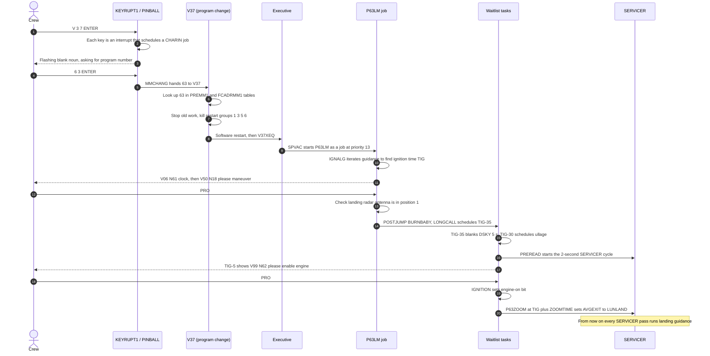
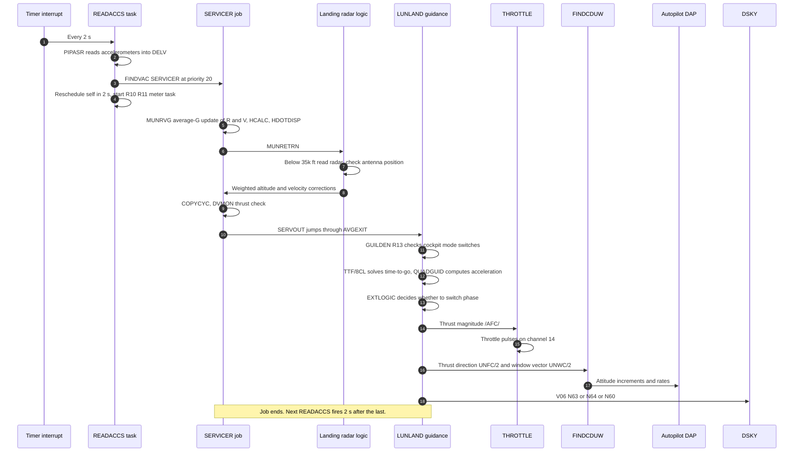
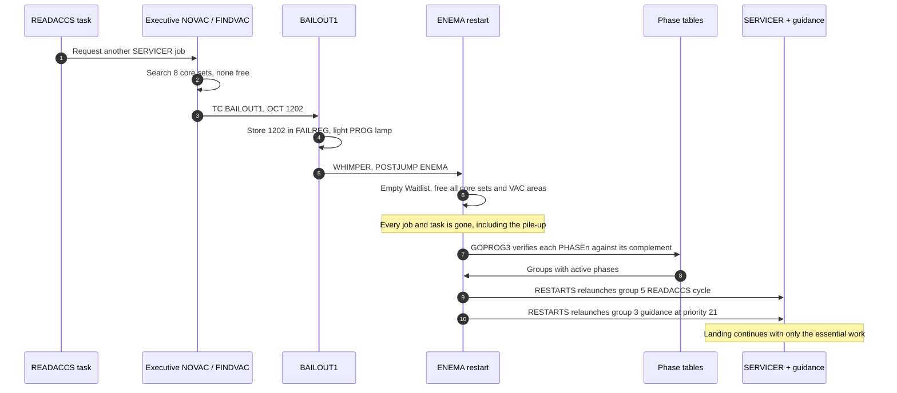
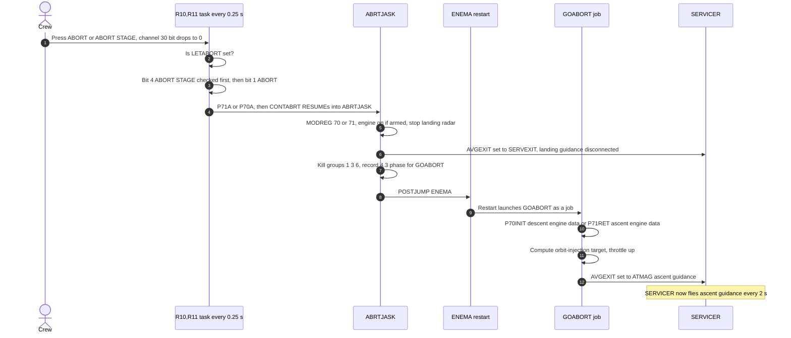

# Descent Event Chains

The AGC has no "main loop". Work happens because something **triggers** it: a keypress interrupt, a Waitlist timer, or a job reaching the top of the Executive's priority queue. An event chain follows one trigger through the system, step by step.

Each diagram has numbered steps. The table under each diagram links every step to the source. For the terms used here (job, task, core set, `PHASCHNG`), see the [glossary](README.md#how-to-read-agc-code-a-short-glossary).

1. [Starting P63: from keypress to engine ignition](#1-starting-p63-from-keypress-to-engine-ignition)
2. [The 2-second guidance cycle](#2-the-2-second-guidance-cycle)
3. [The 1202 alarm: overload, restart, recover](#3-the-1202-alarm-overload-restart-recover)
4. [The abort buttons](#4-the-abort-buttons)

---

## 1. Starting P63: from keypress to engine ignition

The crew keys **V37E63E** about 10 minutes before powered descent initiation. Changing program is itself done with a **software restart**: V37 stops the old program, restarts the computer's job queue, and the restart launches the new program.

| # | Step | Source |
|---|---|---|
| 1-2 | `KEYRUPT1` reads the key code and schedules `CHARIN` as a job via `NOVAC` | [KEYRUPT_UPRUPT.agc:35-55](../../../Luminary099/KEYRUPT_UPRUPT.agc#L35-L55), [PINBALL_GAME_BUTTONS_AND_LIGHTS.agc:463](../../../Luminary099/PINBALL_GAME_BUTTONS_AND_LIGHTS.agc#L463) |
| 3 | Verb table entry for V37 is `MMCHANG`; `REQMM` flashes and blanks the noun to request the program number | [PINBALL_GAME_BUTTONS_AND_LIGHTS.agc:1025](../../../Luminary099/PINBALL_GAME_BUTTONS_AND_LIGHTS.agc#L1025), [:2777-2810](../../../Luminary099/PINBALL_GAME_BUTTONS_AND_LIGHTS.agc#L2777-L2810) |
| 5 | `MMCHANG` requires exactly two digits, then posts to `V37` | [PINBALL_GAME_BUTTONS_AND_LIGHTS.agc:2780-2798](../../../Luminary099/PINBALL_GAME_BUTTONS_AND_LIGHTS.agc#L2780-L2798) |
| 6 | `V37` / `CHECKTAB` search `PREMM1`; the P63 entry is `MM 63 EBANK 7 PRIO 13` | [FRESH_START_AND_RESTART.agc:739](../../../Luminary099/FRESH_START_AND_RESTART.agc#L739), [:1124](../../../Luminary099/FRESH_START_AND_RESTART.agc#L1124) |
| 7 | `SEUDOP00`: engine off, `ALLCOAST`, `V37KLEAN` "KILL GROUPS 1,3,5,6" | [FRESH_START_AND_RESTART.agc:861-888](../../../Luminary099/FRESH_START_AND_RESTART.agc#L861-L888) |
| 8 | `P00FIZZ` → `GOPROG2` restart; group-4 phase 1 relaunches `V37XEQ` via `INITDSP` | [FRESH_START_AND_RESTART.agc:933](../../../Luminary099/FRESH_START_AND_RESTART.agc#L933), [RESTARTS_ROUTINE.agc:50-56](../../../Luminary099/RESTARTS_ROUTINE.agc#L50-L56) |
| 9 | `V37XEQ` builds the address from `FCADRMM1` (`P63LM`) and calls `SPVAC` | [FRESH_START_AND_RESTART.agc:988-1015](../../../Luminary099/FRESH_START_AND_RESTART.agc#L988-L1015) |
| 10 | `IGNALG`: guidance passes until the ignition-time correction is small | [THE_LUNAR_LANDING.agc:77-197](../../../Luminary099/THE_LUNAR_LANDING.agc#L77-L197) |
| 11-12 | `ASTNCLOK` (V06 N61), `R60LEM` (V50 N18) | [THE_LUNAR_LANDING.agc:207](../../../Luminary099/THE_LUNAR_LANDING.agc#L207), [:233](../../../Luminary099/THE_LUNAR_LANDING.agc#L233) |
| 13 | `P63SPOT3`: channel 33 bit 6 antenna check | [THE_LUNAR_LANDING.agc:239-249](../../../Luminary099/THE_LUNAR_LANDING.agc#L239-L249) |
| 14 | `P63SPOT4` → `BURNBABY` → `P41SPOT` / `CALLT-35` | [THE_LUNAR_LANDING.agc:251-255](../../../Luminary099/THE_LUNAR_LANDING.agc#L251-L255), [BURN_BABY_BURN--MASTER_IGNITION_ROUTINE.agc:159-222](../../../Luminary099/BURN_BABY_BURN--MASTER_IGNITION_ROUTINE.agc#L159-L222) |
| 15 | `TIG-35`, `TIG-30` tasks | [BURN_BABY_BURN--MASTER_IGNITION_ROUTINE.agc:250](../../../Luminary099/BURN_BABY_BURN--MASTER_IGNITION_ROUTINE.agc#L250), [:292](../../../Luminary099/BURN_BABY_BURN--MASTER_IGNITION_ROUTINE.agc#L292) |
| 16 | `REDO4.2` → `PREREAD` | [BURN_BABY_BURN--MASTER_IGNITION_ROUTINE.agc:339-343](../../../Luminary099/BURN_BABY_BURN--MASTER_IGNITION_ROUTINE.agc#L339-L343), [SERVICER.agc:42](../../../Luminary099/SERVICER.agc#L42) |
| 17 | `TIG-5` → V99 N62 | [BURN_BABY_BURN--MASTER_IGNITION_ROUTINE.agc:354](../../../Luminary099/BURN_BABY_BURN--MASTER_IGNITION_ROUTINE.agc#L354), [:772-781](../../../Luminary099/BURN_BABY_BURN--MASTER_IGNITION_ROUTINE.agc#L772-L781) |
| 19 | `IGNITION`: `ENGONFLG`, engine-on bit 13 to `DSALMOUT` | [BURN_BABY_BURN--MASTER_IGNITION_ROUTINE.agc:414-422](../../../Luminary099/BURN_BABY_BURN--MASTER_IGNITION_ROUTINE.agc#L414-L422) |
| 20 | `P63ZOOM` loads `LUNLAND` into `AVEGEXIT` and calls `FLATOUT` (full thrust) | [BURN_BABY_BURN--MASTER_IGNITION_ROUTINE.agc:564-584](../../../Luminary099/BURN_BABY_BURN--MASTER_IGNITION_ROUTINE.agc#L564-L584) |

**Inferred:** the keypress-by-keypress order of `REQRET` handling was read from the code, not simulated.

More detail: [P63 page](programs/p63.md).

---

## 2. The 2-second guidance cycle

This is the heartbeat of the landing. Every 2 seconds a Waitlist task reads the accelerometers and schedules **SERVICER**. SERVICER updates the navigation, then calls **whatever routine `AVGEXIT` points to**. During descent that is `LUNLAND`, the landing guidance. Changing one address changes what "flying" means. P70/P71 aborts use the same trick to switch to ascent guidance.

| # | Step | Source |
|---|---|---|
| 1-2 | `READACCS` task; `PIPASR` reads the accelerometers (PIPAs) | [SERVICER.agc:79-92](../../../Luminary099/SERVICER.agc#L79-L92) |
| 3 | `FINDVAC` `SERVICER` at `PRIO20` | [SERVICER.agc:97-100](../../../Luminary099/SERVICER.agc#L97-L100) |
| 4 | `R10,R11` first scheduled 0.2 s later; `MAKEACCS` → `GOREADAX` waits `2SECS` | [SERVICER.agc:132-139](../../../Luminary099/SERVICER.agc#L132-L139), [:72-74](../../../Luminary099/SERVICER.agc#L72-L74) |
| 5 | `MUNRVG`: average-G integration, `HCALC = abs(R) - /LAND/` | [SERVICER.agc:1041-1083](../../../Luminary099/SERVICER.agc#L1041-L1083) |
| 6-8 | `MUNRETRN`: altitude checks, `POSUPDAT` (altitude), `VUPDAT` (velocity) | [SERVICER.agc:717](../../../Luminary099/SERVICER.agc#L717), [:1110](../../../Luminary099/SERVICER.agc#L1110), [:1310](../../../Luminary099/SERVICER.agc#L1310) |
| 9 | `COPYCYC2`, `DVMON` | [SERVICER.agc:842](../../../Luminary099/SERVICER.agc#L842), [:262](../../../Luminary099/SERVICER.agc#L262) |
| 10 | `SERVOUT` → `DCA AVGEXIT / DXCH Z` | [SERVICER.agc:328-342](../../../Luminary099/SERVICER.agc#L328-L342) |
| 11 | `GUILDEN` (R13) | [LUNAR_LANDING_GUIDANCE_EQUATIONS.agc:134](../../../Luminary099/LUNAR_LANDING_GUIDANCE_EQUATIONS.agc#L134) |
| 12 | `TTF/8CL`, `QUADGUID` | [LUNAR_LANDING_GUIDANCE_EQUATIONS.agc:489](../../../Luminary099/LUNAR_LANDING_GUIDANCE_EQUATIONS.agc#L489), [:546](../../../Luminary099/LUNAR_LANDING_GUIDANCE_EQUATIONS.agc#L546) |
| 13 | `EXTLOGIC` | [LUNAR_LANDING_GUIDANCE_EQUATIONS.agc:692](../../../Luminary099/LUNAR_LANDING_GUIDANCE_EQUATIONS.agc#L692) |
| 14-15 | `GDUMP1` → `THROTTLE` | [LUNAR_LANDING_GUIDANCE_EQUATIONS.agc:822](../../../Luminary099/LUNAR_LANDING_GUIDANCE_EQUATIONS.agc#L822), [THROTTLE_CONTROL_ROUTINES.agc:37](../../../Luminary099/THROTTLE_CONTROL_ROUTINES.agc#L37) |
| 16-17 | `FINDCDUW` → DAP | [FINDCDUW--GUIDAP_INTERFACE.agc:118](../../../Luminary099/FINDCDUW--GUIDAP_INTERFACE.agc#L118) |
| 18 | `DISPEXIT` → `P63DISPS` / `P64DISPS` / `VERTDISP` | [LUNAR_LANDING_GUIDANCE_EQUATIONS.agc:835-890](../../../Luminary099/LUNAR_LANDING_GUIDANCE_EQUATIONS.agc#L835-L890) |

What the code says about the hand-off: *"EXIT TO SELECTED ROUTINE WHETHER THERE IS THRUST OR NOT. THE STATE OF STEERSW WILL CONVEY THIS INFORMATION."* ([SERVICER.agc](../../../Luminary099/SERVICER.agc#L328))

**Restart protection:** `LUNLAND` begins by recording *"GROUP 3: PROTECT GUIDANCE WITH PRIO 21 JUST HIGHER THAN SERVICER'S PRIORITY"* ([LUNAR_LANDING_GUIDANCE_EQUATIONS.agc:117-121](../../../Luminary099/LUNAR_LANDING_GUIDANCE_EQUATIONS.agc#L117-L121)). If a restart happens mid-guidance, it is resumed as its own job.

**In P66 the loop runs twice as fast.** `RODCOMP` also runs 1 s after each SERVICER pass. See [P66](programs/p66.md).

---

## 3. The 1202 alarm: overload, restart, recover

**Historical:** During the Apollo 11 descent the rendezvous radar's interface kept sending spurious counter pulses. Each pulse stole a memory cycle from the CPU, roughly 13–15% of its time. SERVICER and guidance could no longer finish before the next 2-second `READACCS` scheduled another SERVICER. Jobs piled up until the Executive ran out of core sets. None of this cycle stealing is visible in the code, because it is hardware behaviour.

**From the code:** what happens next is a designed-in recovery.

| # | Step | Source |
|---|---|---|
| 1 | `READACCS` → `FINDVAC SERVICER` | [SERVICER.agc:97-100](../../../Luminary099/SERVICER.agc#L97-L100) |
| 2-3 | `NEXTCORE` finds no free core set → `TC BAILOUT1` / `OCT 1202` "NO CORE SETS AVAILABLE". (No free VAC area gives `OCT 1201` at line 147.) | [EXECUTIVE.agc:201-208](../../../Luminary099/EXECUTIVE.agc#L201-L208), [:146-147](../../../Luminary099/EXECUTIVE.agc#L146-L147) |
| 4 | `CHKFAIL1` stores the code in `FAILREG` (readable with V05 N09); `PROGLARM` lights PROG | [ALARM_AND_ABORT.agc:66-90](../../../Luminary099/ALARM_AND_ABORT.agc#L66-L90), [:189-192](../../../Luminary099/ALARM_AND_ABORT.agc#L189-L192) |
| 5 | `WHIMPER` → `POSTJUMP ENEMA` | [ALARM_AND_ABORT.agc:144-149](../../../Luminary099/ALARM_AND_ABORT.agc#L144-L149) |
| 6 | `STARTSB2`: Waitlist emptied, "MAKE ALL EXECUTIVE REGISTER SETS AVAILABLE", "MAKE ALL VAC AREAS AVAILABLE" | [FRESH_START_AND_RESTART.agc:428-579](../../../Luminary099/FRESH_START_AND_RESTART.agc#L428-L579) |
| 7 | `GOPROG3`: phase-table check (a mismatch is alarm 1107, which forces a fresh start) | [FRESH_START_AND_RESTART.agc:290-347](../../../Luminary099/FRESH_START_AND_RESTART.agc#L290-L347) |
| 8 | `NXTRST` / `PACTIVE` call `RESTARTS` for each active group | [FRESH_START_AND_RESTART.agc:324-334](../../../Luminary099/FRESH_START_AND_RESTART.agc#L324-L334), [RESTARTS_ROUTINE.agc:35](../../../Luminary099/RESTARTS_ROUTINE.agc#L35) |
| 9 | Group 5: `SERVICER` records "RESTART REREADAC + SERVICER" | [SERVICER.agc:175-179](../../../Luminary099/SERVICER.agc#L175-L179) |
| 10 | Group 3: `LUNLAND` records guidance at priority 21 | [LUNAR_LANDING_GUIDANCE_EQUATIONS.agc:117-121](../../../Luminary099/LUNAR_LANDING_GUIDANCE_EQUATIONS.agc#L117-L121) |

The two codes are listed in the alarm table at [ASSEMBLY_AND_OPERATION_INFORMATION.agc:966-967](../../../Luminary099/ASSEMBLY_AND_OPERATION_INFORMATION.agc#L966-L967): `01201 EXECUTIVE OVERFLOW - NO VAC AREAS` and `01202 EXECUTIVE OVERFLOW - NO CORE SETS`.

**Why it worked:** a routine survives a restart only if it recorded a phase with `PHASCHNG`. Navigation, guidance and the engine state did; the low-priority jobs that had piled up did not. The restart therefore dropped exactly the excess. Some hardware state is deliberately kept across a software restart: *"DURING SOFTWARE RESTART, DO NOT DISTURB ENGINE ON, OFF AND ISS WARNING"* ([FRESH_START_AND_RESTART.agc:428-430](../../../Luminary099/FRESH_START_AND_RESTART.agc#L428-L430)). P66 even re-initializes itself after one: `RESTART?` checks `RODFLAG` ([LUNAR_LANDING_GUIDANCE_EQUATIONS.agc:210](../../../Luminary099/LUNAR_LANDING_GUIDANCE_EQUATIONS.agc#L210)).

**How many core sets?** Memory holds **8 core sets of 12 words** ([ERASABLE_ASSIGNMENTS.agc:374-383](../../../Luminary099/ERASABLE_ASSIGNMENTS.agc#L374-L383)). The search loop checks all 8 (`NO.CORES DEC 7` counts down 7..0, [EXECUTIVE.agc:157-162](../../../Luminary099/EXECUTIVE.agc#L157-L162)), and the restart clears all 8. **Core set 0 always holds the running job**: the Executive swaps a new job into set 0 to run it ([EXECUTIVE.agc:210](../../../Luminary099/EXECUTIVE.agc#L210)). That leaves **7 for waiting jobs**, which is why historical accounts say 7. The comment "SEVEN SETS OF ELEVEN" counts the same way, though its "eleven" doesn't match the 12-word layout. **Inferred** from the swap logic.

**Can this be prevented?** See the enhancement proposal [Stop the rendezvous radar draining the CPU during descent](enhancements/rr-cpu-drain.md).

---

## 4. The abort buttons

The **ABORT** button (abort on the descent engine) starts **P70**. The **ABORT STAGE** button (separate the stages and fly the ascent engine) starts **P71**. The buttons are not interrupts: a 4-times-per-second Waitlist task polls them.

| # | Step | Source |
|---|---|---|
| 1 | Channel 30 bit 1 = "ABORT WITH DESCENT STAGE"; bit 4 = "ABORT WITH ASCENT ENGINE STAGE" | [INPUT_OUTPUT_CHANNEL_BIT_DESCRIPTIONS.agc:148-151](../../../Luminary099/INPUT_OUTPUT_CHANNEL_BIT_DESCRIPTIONS.agc#L148-L151) |
| 2 | `LETABORT` check (set at ignition by `P63IGN`, cleared by P68) | [P70-P71.agc:72-76](../../../Luminary099/P70-P71.agc#L72-L76) |
| 3 | `P71NOW?`, bit 4 → `P71A`; `P70NOW?`, bit 1 → `P70A` | [P70-P71.agc:77-100](../../../Luminary099/P70-P71.agc#L77-L100) |
| 4 | `P70A` / `P71A` → `CONTABRT` | [P70-P71.agc:105-128](../../../Luminary099/P70-P71.agc#L105-L128) |
| 5-7 | `ABRTJASK` takeover | [P70-P71.agc:133-197](../../../Luminary099/P70-P71.agc#L133-L197) |
| 8 | `POSTJUMP ENEMA` | [P70-P71.agc:202-203](../../../Luminary099/P70-P71.agc#L202-L203) |
| 9-10 | `GOABORT` → `CHECKMM 70` → `P70INIT` / `P71RET` | [P70-P71.agc:220-277](../../../Luminary099/P70-P71.agc#L220-L277), [:340](../../../Luminary099/P70-P71.agc#L340) |
| 11-12 | `UPTHROT` / `UPTHROT1`: "SET SERVICER TO CALL ASCENT GUIDANCE" | [P70-P71.agc:315-338](../../../Luminary099/P70-P71.agc#L315-L338), [ASCENT_GUIDANCE.agc:38](../../../Luminary099/ASCENT_GUIDANCE.agc#L38) |

Notice the pattern: the abort **reuses the 1202 recovery mechanism** (`ENEMA` plus phase tables) to switch programs cleanly in mid-flight. More detail: [P70 / P71 page](programs/p70-p71.md).
