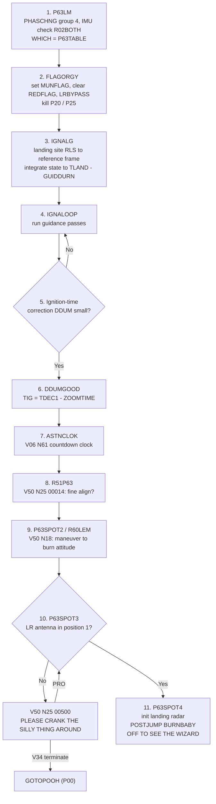
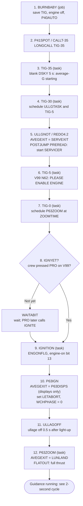
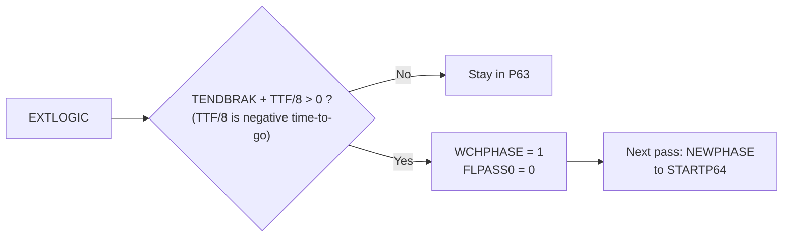

# P63: Braking Phase

[← Descent overview](../README.md) · Next: [P64 →](p64.md)

**What it does:** prepares for powered descent, finds the right moment to light the descent engine, lights it, and flies the braking phase. Braking removes most of the LM's orbital velocity while descending from about 50,000 ft.

**Entry:** `P63LM`, [THE_LUNAR_LANDING.agc:40](../../../../Luminary099/THE_LUNAR_LANDING.agc#L40), started by V37E63E as a job at priority 13 ([FRESH_START_AND_RESTART.agc:1124](../../../../Luminary099/FRESH_START_AND_RESTART.agc#L1124)). For how the keypress reaches this point, see [event chain 1](../event-chains.md#1-starting-p63-from-keypress-to-engine-ignition).

## Part 1: Pre-ignition (the P63 job)

| # | Source | Notes |
|---|---|---|
| 1 | [THE_LUNAR_LANDING.agc:40-61](../../../../Luminary099/THE_LUNAR_LANDING.agc#L40-L61) | Also sets `WCHPHASE = -1` (ignition algorithm) and initializes the ΔV monitor |
| 2 | [THE_LUNAR_LANDING.agc:64](../../../../Luminary099/THE_LUNAR_LANDING.agc#L64) | Label comment: "DIONYSIAN FLAG WAVING" |
| 3-5 | [THE_LUNAR_LANDING.agc:77-186](../../../../Luminary099/THE_LUNAR_LANDING.agc#L77-L186) | `?GUIDSUB` "DELIVERS N PASSES OF GUIDANCE"; `DDUMCALC` at :135 |
| 6 | [THE_LUNAR_LANDING.agc:187-197](../../../../Luminary099/THE_LUNAR_LANDING.agc#L187-L197) | `R60INIT` saves the burn attitude in `R60VSAVE` |
| 7 | [THE_LUNAR_LANDING.agc:204-207](../../../../Luminary099/THE_LUNAR_LANDING.agc#L204-L207) | `IGNALGRT` records a phase to "PREVENT REPEATING IGNALG" |
| 8 | [THE_LUNAR_LANDING.agc:212](../../../../Luminary099/THE_LUNAR_LANDING.agc#L212), [P51-P53.agc:715](../../../../Luminary099/P51-P53.agc#L715) | Started when the crew presses PRO on N61 |
| 9 | [THE_LUNAR_LANDING.agc:217-234](../../../../Luminary099/THE_LUNAR_LANDING.agc#L217-L234) | KALCMANU attitude maneuver |
| 10 | [THE_LUNAR_LANDING.agc:239-249](../../../../Luminary099/THE_LUNAR_LANDING.agc#L239-L249) | Channel 33 bit 6 |
| 11 | [THE_LUNAR_LANDING.agc:251-255](../../../../Luminary099/THE_LUNAR_LANDING.agc#L251-L255) | |

## Part 2: Ignition countdown (BURNBABY and Waitlist tasks)

`BURNBABY` is shared by every powered-flight program. It reads a per-program table, so P63 uses `P63TABLE`. In this phase the timing is carried by a **chain of Waitlist tasks**, each scheduling the next.

| # | Source |
|---|---|
| 1 | [BURN_BABY_BURN--MASTER_IGNITION_ROUTINE.agc:159-183](../../../../Luminary099/BURN_BABY_BURN--MASTER_IGNITION_ROUTINE.agc#L159-L183) |
| 2 | [:188-246](../../../../Luminary099/BURN_BABY_BURN--MASTER_IGNITION_ROUTINE.agc#L188-L246) |
| 3 | [:250-255](../../../../Luminary099/BURN_BABY_BURN--MASTER_IGNITION_ROUTINE.agc#L250-L255), comment at [:786-788](../../../../Luminary099/BURN_BABY_BURN--MASTER_IGNITION_ROUTINE.agc#L786-L788) |
| 4 | [:292](../../../../Luminary099/BURN_BABY_BURN--MASTER_IGNITION_ROUTINE.agc#L292), `ULLGTASK` at [:347](../../../../Luminary099/BURN_BABY_BURN--MASTER_IGNITION_ROUTINE.agc#L347) |
| 5 | [:321-343](../../../../Luminary099/BURN_BABY_BURN--MASTER_IGNITION_ROUTINE.agc#L321-L343), [SERVICER.agc:42](../../../../Luminary099/SERVICER.agc#L42) |
| 6 | [:354-384](../../../../Luminary099/BURN_BABY_BURN--MASTER_IGNITION_ROUTINE.agc#L354-L384) |
| 7 | [:390-403](../../../../Luminary099/BURN_BABY_BURN--MASTER_IGNITION_ROUTINE.agc#L390-L403) |
| 8 | [:408](../../../../Luminary099/BURN_BABY_BURN--MASTER_IGNITION_ROUTINE.agc#L408), `WAITABIT` [:535](../../../../Luminary099/BURN_BABY_BURN--MASTER_IGNITION_ROUTINE.agc#L535), `IGNITE` [:860](../../../../Luminary099/BURN_BABY_BURN--MASTER_IGNITION_ROUTINE.agc#L860) |
| 9 | [:414-422](../../../../Luminary099/BURN_BABY_BURN--MASTER_IGNITION_ROUTINE.agc#L414-L422) |
| 10 | [:442-520](../../../../Luminary099/BURN_BABY_BURN--MASTER_IGNITION_ROUTINE.agc#L442-L520) |
| 11 | [:533](../../../../Luminary099/BURN_BABY_BURN--MASTER_IGNITION_ROUTINE.agc#L533) |
| 12 | [:564-584](../../../../Luminary099/BURN_BABY_BURN--MASTER_IGNITION_ROUTINE.agc#L564-L584), `FLATOUT` [THROTTLE_CONTROL_ROUTINES.agc:191](../../../../Luminary099/THROTTLE_CONTROL_ROUTINES.agc#L191) |

> *"THROTTLE-UP IS ZOOMTIME AFTER NOMINAL IGNITION, NOT ACTUAL"*: comment at TIG-0 ([:394-403](../../../../Luminary099/BURN_BABY_BURN--MASTER_IGNITION_ROUTINE.agc#L394-L403))

**Key idea: `AVEGEXIT` changes three times.** It is first `SERVEXIT` (navigation only), then `P63DISPS` (navigation plus displays), then `LUNLAND` (full guidance). That address is how the program sets what SERVICER does after each navigation pass.

## Part 3: Braking guidance and the switch to P64

Once `LUNLAND` is connected, P63 is just the [2-second cycle](../event-chains.md#2-the-2-second-guidance-cycle) running with `WCHPHASE = 0` (`BRAKQUAD`, the braking targets). At the end of every pass, `EXTLOGIC` asks whether braking is done:

Source: [LUNAR_LANDING_GUIDANCE_EQUATIONS.agc:692-706](../../../../Luminary099/LUNAR_LANDING_GUIDANCE_EQUATIONS.agc#L692-L706). `TENDBRAK` is a pad-loaded "LANDING PHASE SWITCHING CRITERION" ([ERASABLE_ASSIGNMENTS.agc:2096](../../../../Luminary099/ERASABLE_ASSIGNMENTS.agc#L2096)); its value is not in this source.

## DSKY displays in P63

| Display | Meaning | Source |
|---|---|---|
| V06 N61 | Time to ignition clock; the crew syncs their event timer | [BURN_BABY_BURN--MASTER_IGNITION_ROUTINE.agc:753](../../../../Luminary099/BURN_BABY_BURN--MASTER_IGNITION_ROUTINE.agc#L753) |
| V50 N25 00014 | Fine-align option: PRO = align, ENTER = skip | [P51-P53.agc:715](../../../../Luminary099/P51-P53.agc#L715) |
| V50 N18 | Please perform auto maneuver to burn attitude | [R60_62.agc:122-124](../../../../Luminary099/R60_62.agc#L122-L124) |
| V50 N25 00500 | Put the landing radar antenna in position 1 | [THE_LUNAR_LANDING.agc:245-249](../../../../Luminary099/THE_LUNAR_LANDING.agc#L245-L249) |
| Blank, 5 s | TIG-35: average-G starting | [BURN_BABY_BURN--MASTER_IGNITION_ROUTINE.agc:786-788](../../../../Luminary099/BURN_BABY_BURN--MASTER_IGNITION_ROUTINE.agc#L786-L788) |
| V06 N62 / V99 N62 | Countdown / please enable engine | [BURN_BABY_BURN--MASTER_IGNITION_ROUTINE.agc:762-781](../../../../Luminary099/BURN_BABY_BURN--MASTER_IGNITION_ROUTINE.agc#L762-L781) |
| V06 N63 | Braking-phase display after ignition | [LUNAR_LANDING_GUIDANCE_EQUATIONS.agc:850](../../../../Luminary099/LUNAR_LANDING_GUIDANCE_EQUATIONS.agc#L850) |

**Inferred / historical:** the "about 50,000 ft" figure is mission context. `ZOOMTIME` and `TENDBRAK` are pad loads whose values are not in this repo.
