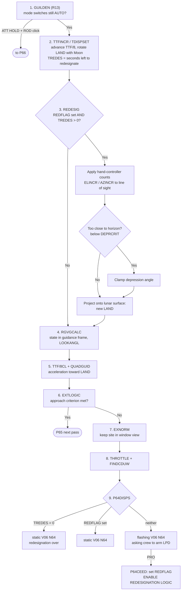
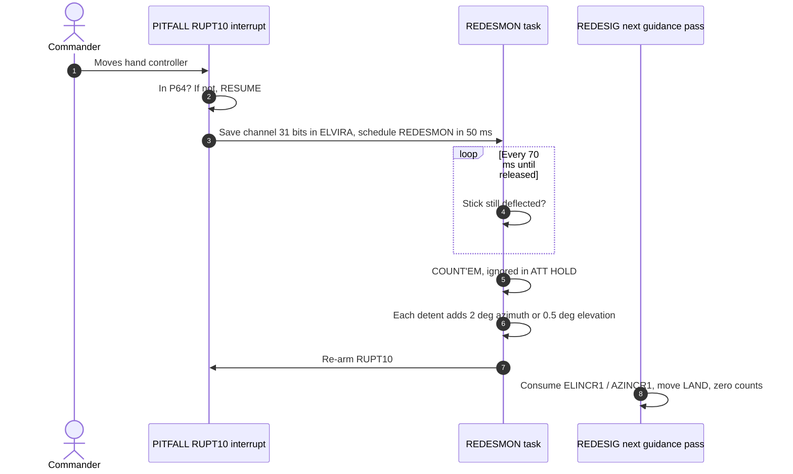

# P64: Approach Phase

[← P63](p63.md) · [Descent overview](../README.md) · Next: [P66 →](p66.md)

**What it does:** the LM pitches over so the landing site is visible through the commander's window. Guidance flies toward new approach targets. The commander can **redesignate** (move) the landing site with the hand controller, using the landing point designator (LPD) reticle scribed on the window.

**Entry:** `STARTP64`, [LUNAR_LANDING_GUIDANCE_EQUATIONS.agc:260](../../../../Luminary099/LUNAR_LANDING_GUIDANCE_EQUATIONS.agc#L260). It is not started from the keyboard. Guidance switches to it automatically when the braking phase ends (see [P63 part 3](p63.md#part-3-braking-guidance-and-the-switch-to-p64)).

P64 isn't a separate job. It is the same `LUNLAND` guidance inside the [2-second cycle](../event-chains.md#2-the-2-second-guidance-cycle), using phase index `WCHPHASE = 1`. That index selects different targets, pre-guidance and display routines from dispatch tables at [LUNAR_LANDING_GUIDANCE_EQUATIONS.agc:41-99](../../../../Luminary099/LUNAR_LANDING_GUIDANCE_EQUATIONS.agc#L41-L99).

## What STARTP64 changes (runs once)

| Change | Source |
|---|---|
| `NEWMODEX 64`, so PROG shows 64 | [:260](../../../../Luminary099/LUNAR_LANDING_GUIDANCE_EQUATIONS.agc#L260) |
| Adds `DELTTFAP` to `TTF/8`: "INCREMENT ADDED TO TTF/8 WHEN SWITCHING FROM P63 TO P64" | [:260-268](../../../../Luminary099/LUNAR_LANDING_GUIDANCE_EQUATIONS.agc#L260-L268), [ERASABLE_ASSIGNMENTS.agc:2098](../../../../Luminary099/ERASABLE_ASSIGNMENTS.agc#L2098) |
| Enables `RUPT10`, the hand-controller interrupt (channel 13 bit 12) | [:260-268](../../../../Luminary099/LUNAR_LANDING_GUIDANCE_EQUATIONS.agc#L260-L268) |
| Clears `REDFLAG`: redesignation is **off** until the crew arms it | [:260-268](../../../../Luminary099/LUNAR_LANDING_GUIDANCE_EQUATIONS.agc#L260-L268) |
| Target index `TARGTDEX` now selects the approach targets (`RDG`, `VDG`, `ADG`, `JDG`) | [:97-99](../../../../Luminary099/LUNAR_LANDING_GUIDANCE_EQUATIONS.agc#L97-L99) |
| Pre-guidance routine becomes `REDESIG`; display routine becomes `P64DISPS` | [:59](../../../../Luminary099/LUNAR_LANDING_GUIDANCE_EQUATIONS.agc#L59), [:86](../../../../Luminary099/LUNAR_LANDING_GUIDANCE_EQUATIONS.agc#L86) |

## One P64 guidance pass

| # | Source |
|---|---|
| 1 | [LUNAR_LANDING_GUIDANCE_EQUATIONS.agc:134-230](../../../../Luminary099/LUNAR_LANDING_GUIDANCE_EQUATIONS.agc#L134-L230) (see [P66](p66.md)) |
| 2 | [:288-330](../../../../Luminary099/LUNAR_LANDING_GUIDANCE_EQUATIONS.agc#L288-L330), `TDISPSET` [:1384-1410](../../../../Luminary099/LUNAR_LANDING_GUIDANCE_EQUATIONS.agc#L1384-L1410) |
| 3 | `REDESIG` [:335-405](../../../../Luminary099/LUNAR_LANDING_GUIDANCE_EQUATIONS.agc#L335-L405); "MAKE SURE REDESIGNATION IS NOT TOO CLOSE TO THE HORIZON" [:377-383](../../../../Luminary099/LUNAR_LANDING_GUIDANCE_EQUATIONS.agc#L377-L383) |
| 4 | `RGVGCALC` [:442-485](../../../../Luminary099/LUNAR_LANDING_GUIDANCE_EQUATIONS.agc#L442-L485); "LOOKANGL FOR DISPLAY DURING P64" [:480](../../../../Luminary099/LUNAR_LANDING_GUIDANCE_EQUATIONS.agc#L480) |
| 5 | [:489-600](../../../../Luminary099/LUNAR_LANDING_GUIDANCE_EQUATIONS.agc#L489-L600) |
| 6 | [:692-706](../../../../Luminary099/LUNAR_LANDING_GUIDANCE_EQUATIONS.agc#L692-L706); P65 entry `P65START` [:252](../../../../Luminary099/LUNAR_LANDING_GUIDANCE_EQUATIONS.agc#L252) |
| 7 | `EXNORM` [:748-797](../../../../Luminary099/LUNAR_LANDING_GUIDANCE_EQUATIONS.agc#L748-L797) |
| 8 | `STEER?` [:799](../../../../Luminary099/LUNAR_LANDING_GUIDANCE_EQUATIONS.agc#L799), `GDUMP1` [:822](../../../../Luminary099/LUNAR_LANDING_GUIDANCE_EQUATIONS.agc#L822) |
| 9 | `P64DISPS` [:856-887](../../../../Luminary099/LUNAR_LANDING_GUIDANCE_EQUATIONS.agc#L856-L887), `P64CEED` [:874](../../../../Luminary099/LUNAR_LANDING_GUIDANCE_EQUATIONS.agc#L874) |

> *"TREDES BECOMES ZERO TWO PASSES BEFORE TCGFAPPR IS REACHED"*: [LUNAR_LANDING_GUIDANCE_EQUATIONS.agc:1389](../../../../Luminary099/LUNAR_LANDING_GUIDANCE_EQUATIONS.agc#L1389)

## The hand-controller path (asynchronous)

Moving the stick does **not** wait for the guidance pass. It raises an interrupt that counts "clicks". The next guidance pass consumes the counts in `REDESIG` (step 3 above).

| # | Source |
|---|---|
| 1-3 | `PITFALL` [LUNAR_LANDING_GUIDANCE_EQUATIONS.agc:1130-1148](../../../../Luminary099/LUNAR_LANDING_GUIDANCE_EQUATIONS.agc#L1130-L1148); "RUPT10 IS USED ONLY BY LANDING GUIDANCE" [INTERRUPT_LEAD_INS.agc:83-86](../../../../Luminary099/INTERRUPT_LEAD_INS.agc#L83-L86) |
| 4 | `REDESMON` [:1155-1186](../../../../Luminary099/LUNAR_LANDING_GUIDANCE_EQUATIONS.agc#L1155-L1186) |
| 5-6 | `COUNT'EM` [:1188-1224](../../../../Luminary099/LUNAR_LANDING_GUIDANCE_EQUATIONS.agc#L1188-L1224) (`AZEACH` / `ELEACH`) |
| 7 | `RESETRPT` [:1184-1186](../../../../Luminary099/LUNAR_LANDING_GUIDANCE_EQUATIONS.agc#L1184-L1186) |
| 8 | `REDESIG` [:345-355](../../../../Luminary099/LUNAR_LANDING_GUIDANCE_EQUATIONS.agc#L345-L355) |

The programmers' labels here are `PITFALL`, `ELVIRA` and `ZERLINA`. Next door, the mode-switch monitor is `GUILDEN`/`STERN` ("Guildenstern"), and the throttle code is `RODCOMP`.

## DSKY display: V06 N64

| Register | Contents | Source |
|---|---|---|
| R1 | Two numbers: seconds left to redesignate (`TREDES`) and the LPD angle (`LOOKANGL`). The commander reads the angle against the window reticle. | [PINBALL_NOUN_TABLES.agc:312-314](../../../../Luminary099/PINBALL_NOUN_TABLES.agc#L312-L314) |
| R2 | Altitude rate (`HDOTDISP`) | same |
| R3 | Altitude (`HCALC`) | same |

**Inferred:** that the LPD angle is read against a window reticle comes from the definition of `LOOKANGL` (the angle between the line of sight to the site and the vehicle X axis) and from mission documentation. The code doesn't describe the cockpit hardware.
