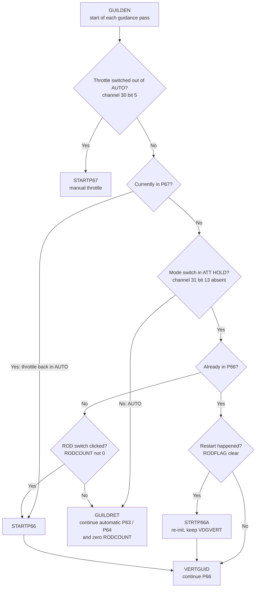
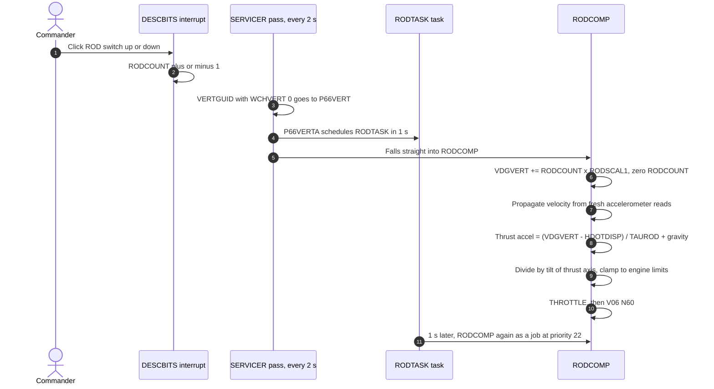

# P66: Rate of Descent

[← P64](p64.md) · [Descent overview](../README.md) · Next: [P68 →](p68.md)

**What it does:** the final, semi-manual part of the landing. The computer **holds a commanded descent rate** with the throttle. The commander flies **attitude** with the hand controller, which controls horizontal motion. Each click of the ROD (rate-of-descent) switch nudges the commanded descent rate up or down.

**Historical:** Neil Armstrong flew Apollo 11's final descent in P66, steering past a boulder field.

## How P66 is selected

P66 is not keyed in. `GUILDEN` (routine R13) checks the cockpit switches at the start of **every** guidance pass:

Source: [LUNAR_LANDING_GUIDANCE_EQUATIONS.agc:134-231](../../../../Luminary099/LUNAR_LANDING_GUIDANCE_EQUATIONS.agc#L134-L231).

**Two crew actions are needed:** ATT HOLD **and** a ROD click. ATT HOLD alone keeps the automatic landing running: *"NO. CONTINUE WITH AUTOMATIC LANDING"* ([:205-207](../../../../Luminary099/LUNAR_LANDING_GUIDANCE_EQUATIONS.agc#L205-L207)). Clicks made while still in AUTO are thrown away, because `GUILDRET` zeroes `RODCOUNT` on every automatic pass ([:224-225](../../../../Luminary099/LUNAR_LANDING_GUIDANCE_EQUATIONS.agc#L224-L225)).

> *"HERE IS THE PHILOSOPHY OF GUILDENSTERN: ON EVERY APPEARANCE OR DISAPPEARANCE OF THE MANUAL THROTTLE DISCRETE TO SELECT P67 OR P66 RESPECTIVELY: ON EVERY APPEARANCE OF THE ATTITUDE-HOLD DISCRETE TO SELECT P66 UNLESS THE CURRENT PROGRAM IS P67 IN WHICH CASE THERE IS NO CHANGE"*: [:130-132](../../../../Luminary099/LUNAR_LANDING_GUIDANCE_EQUATIONS.agc#L130-L132)

## What STARTP66 sets up

| Action | Source |
|---|---|
| `NEWMODEX 66` | [:143-145](../../../../Luminary099/LUNAR_LANDING_GUIDANCE_EQUATIONS.agc#L143-L145) |
| **Desired descent rate = current descent rate** (`VDGVERT = HDOTDISP`), so there's no jolt at switch-over | [:146-148](../../../../Luminary099/LUNAR_LANDING_GUIDANCE_EQUATIONS.agc#L146-L148) |
| `STRTP66A`: accelerometer bias, sets `RODFLAG`, click scale `RODSCAL1 = RODSCALE` | [:149-170](../../../../Luminary099/LUNAR_LANDING_GUIDANCE_EQUATIONS.agc#L149-L170) |
| `WCHPHASE = 2` ("VERTICAL: P65,P66,P67") | [:175-178](../../../../Luminary099/LUNAR_LANDING_GUIDANCE_EQUATIONS.agc#L175-L178) |
| `STOPRATE` (commented "TEMPORARY, I HOPE HOPE HOPE"), permit X-axis override, clear `REDFLAG` so no more LPD | [:179-185](../../../../Luminary099/LUNAR_LANDING_GUIDANCE_EQUATIONS.agc#L179-L185) |

## The P66 loop: twice as fast

| # | Source |
|---|---|
| 1-2 | `DESCBITS`: "BIT 7 MEANS - RATE INCREMENT, BIT 6 + INCREMENT" [LUNAR_LANDING_GUIDANCE_EQUATIONS.agc:1223-1228](../../../../Luminary099/LUNAR_LANDING_GUIDANCE_EQUATIONS.agc#L1223-L1228), reached from channel 16 bits 6/7 [AOTMARK.agc:472-479](../../../../Luminary099/AOTMARK.agc#L472-L479) |
| 3 | `VERTGUID` [:897-899](../../../../Luminary099/LUNAR_LANDING_GUIDANCE_EQUATIONS.agc#L897-L899), `P66VERT` [:919](../../../../Luminary099/LUNAR_LANDING_GUIDANCE_EQUATIONS.agc#L919) |
| 4 | `P66VERTA` [:941-946](../../../../Luminary099/LUNAR_LANDING_GUIDANCE_EQUATIONS.agc#L941-L946), `RODTASK` [:934-939](../../../../Luminary099/LUNAR_LANDING_GUIDANCE_EQUATIONS.agc#L934-L939) |
| 5-6 | `RODCOMP`: "UPDATE DESIRED ALTITUDE RATE" [:948-953](../../../../Luminary099/LUNAR_LANDING_GUIDANCE_EQUATIONS.agc#L948-L953) |
| 7 | [:955-1030](../../../../Luminary099/LUNAR_LANDING_GUIDANCE_EQUATIONS.agc#L955-L1030) |
| 8-9 | [:1031-1095](../../../../Luminary099/LUNAR_LANDING_GUIDANCE_EQUATIONS.agc#L1031-L1095) |
| 10 | [:1099-1113](../../../../Luminary099/LUNAR_LANDING_GUIDANCE_EQUATIONS.agc#L1099-L1113) |
| 11 | [:934-939](../../../../Luminary099/LUNAR_LANDING_GUIDANCE_EQUATIONS.agc#L934-L939) |

The throttle code confirms the faster rate: its guidance period `PGUID` is "EITHER 1 OR 2 SECONDS", and it uses the shorter one when `MODREG = 66` ([THROTTLE_CONTROL_ROUTINES.agc:131-158](../../../../Luminary099/THROTTLE_CONTROL_ROUTINES.agc#L131-L158)).

**The computer does not steer horizontally in P66.** `FINDCDUW` isn't called, and `STOPRATE` was issued. The commander controls horizontal velocity by tilting the LM in ATT HOLD. `RODCOMP` only computes horizontal velocity (`VHORIZ`) for the display ([:1104-1110](../../../../Luminary099/LUNAR_LANDING_GUIDANCE_EQUATIONS.agc#L1104-L1110)).

## DSKY display: V06 N60

| Register | Contents | Source |
|---|---|---|
| R1 | Horizontal velocity (`VHORIZ`) | [PINBALL_NOUN_TABLES.agc:300-302](../../../../Luminary099/PINBALL_NOUN_TABLES.agc#L300-L302) |
| R2 | Altitude rate (`HDOTDISP`) | same |
| R3 | Altitude (`HCALC`) | same |

Some source comments still say "FOR NOUN 63" ([:1022](../../../../Luminary099/LUNAR_LANDING_GUIDANCE_EQUATIONS.agc#L1022)), but `VERTDISP` displays N60 ([:889-890](../../../../Luminary099/LUNAR_LANDING_GUIDANCE_EQUATIONS.agc#L889-L890)).

## Relatives: P65 and P67

- **P65** (automatic vertical descent): reached if the approach criterion `TENDAPPR` is met while still automatic (`P65START`, [:252-258](../../../../Luminary099/LUNAR_LANDING_GUIDANCE_EQUATIONS.agc#L252-L258)). It flies `ACG = (V2FG - VGU) / TAUVERT` ([`P65VERT` :907-913](../../../../Luminary099/LUNAR_LANDING_GUIDANCE_EQUATIONS.agc#L907-L913)).
- **P67** (manual throttle): the crew controls the throttle directly, and the computer only computes displays ([:922-928](../../../../Luminary099/LUNAR_LANDING_GUIDANCE_EQUATIONS.agc#L922-L928)).

**Inferred / historical:** "1 ft/s per click" is mission documentation; `RODSCALE` is a pad load not in this repo. Whether P65 is reachable in practice depends on the pad-loaded `TENDAPPR`. On Apollo 11 the crew entered P66 from P64.
