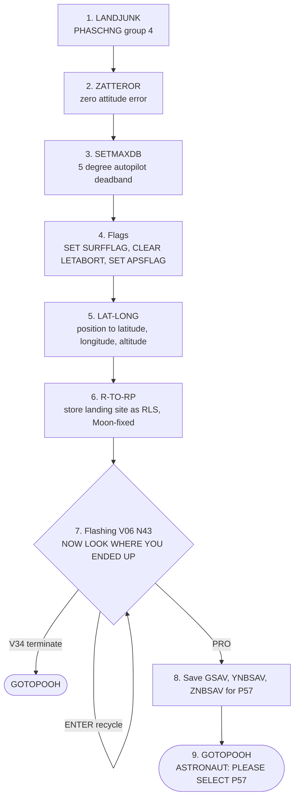

# P68: Landing Confirmation

[← P66](p66.md) · [Descent overview](../README.md) · Next: [P70 / P71 →](p70-p71.md)

**What it does:** after touchdown, P68 tells the computer it is on the surface. It quiets the autopilot, records where the LM landed, and prepares for P57, the lunar-surface alignment.

**Entry:** `LANDJUNK`, [THE_LUNAR_LANDING.agc:286](../../../../Luminary099/THE_LUNAR_LANDING.agc#L286). The crew keys V37E68E. The `FCADRMM1` table entry is at [FRESH_START_AND_RESTART.agc:1070](../../../../Luminary099/FRESH_START_AND_RESTART.agc#L1070). Nothing in the landing code switches to P68 automatically: `LANDJUNK` appears only at its definition and in that table.

## The V37 cleanup comes first

Most of the "stop the descent" work is done by the **generic V37 program-change machinery**, not by P68 itself. See [event chain 1](../event-chains.md#1-starting-p63-from-keypress-to-engine-ignition) for the same path.

| V37 step | Effect | Source |
|---|---|---|
| Lower `AVEGFLAG` | SERVICER stops at its next pass: "TURN OFF THE AVERAGE FLAG AND WAIT FOR SERVICER" | [FRESH_START_AND_RESTART.agc:794-795](../../../../Luminary099/FRESH_START_AND_RESTART.agc#L794-L795) |
| `ENGINOF1` | Engine and throttle path off | [:875-876](../../../../Luminary099/FRESH_START_AND_RESTART.agc#L875-L876) |
| `V37KLEAN` | "KILL GROUPS 1,3,5,6", so guidance is no longer restart-protected | [:887-888](../../../../Luminary099/FRESH_START_AND_RESTART.agc#L887-L888) |
| `V37XEQ` | Starts `LANDJUNK` as a job | [:988-1015](../../../../Luminary099/FRESH_START_AND_RESTART.agc#L988-L1015) |

## LANDJUNK

| # | Source | Notes |
|---|---|---|
| 1 | [THE_LUNAR_LANDING.agc:286-287](../../../../Luminary099/THE_LUNAR_LANDING.agc#L286-L287) | |
| 2 | [:289-291](../../../../Luminary099/THE_LUNAR_LANDING.agc#L289-L291) | `ZATTEROR` at [DAP_INTERFACE_SUBROUTINES.agc:113](../../../../Luminary099/DAP_INTERFACE_SUBROUTINES.agc#L113) |
| 3 | [:293-294](../../../../Luminary099/THE_LUNAR_LANDING.agc#L293-L294) | `SETMAXDB` at [DAP_INTERFACE_SUBROUTINES.agc:87](../../../../Luminary099/DAP_INTERFACE_SUBROUTINES.agc#L87) |
| 4 | [:297-301](../../../../Luminary099/THE_LUNAR_LANDING.agc#L297-L301) | Clearing `LETABORT` disables the abort buttons ([P70 / P71](p70-p71.md)) |
| 5 | [:302-307](../../../../Luminary099/THE_LUNAR_LANDING.agc#L302-L307) | [LATITUDE_LONGITUDE_SUBROUTINES.agc:56](../../../../Luminary099/LATITUDE_LONGITUDE_SUBROUTINES.agc#L56) |
| 6 | [:308-315](../../../../Luminary099/THE_LUNAR_LANDING.agc#L308-L315) | "COMPUTE RLS AND STORE IT AWAY" |
| 7 | [:317-322](../../../../Luminary099/THE_LUNAR_LANDING.agc#L317-L322) | `V06N43*` = `VN 0643` at [:334](../../../../Luminary099/THE_LUNAR_LANDING.agc#L334) |
| 8 | [:326-329](../../../../Luminary099/THE_LUNAR_LANDING.agc#L326-L329) | `REFMF` at [P51-P53.agc:2183](../../../../Luminary099/P51-P53.agc#L2183) |
| 9 | [:332](../../../../Luminary099/THE_LUNAR_LANDING.agc#L332) | |

The code switches to the interpreter *"AS TIME IS NOT CRITICAL"* ([:296](../../../../Luminary099/THE_LUNAR_LANDING.agc#L296)). The same thought could be the motto for the whole program: the hard part is over.

## DSKY display: V06 N43 (flashing)

| Register | Contents |
|---|---|
| R1 | Latitude |
| R2 | Longitude |
| R3 | Altitude |

**Inferred:** that the crew keyed V37E68E right after touchdown is mission procedure; the code only shows P68 as a keyboard-selectable program. What `APSFLAG` changes downstream (ascent-stage mass and autopilot settings) was not traced.
