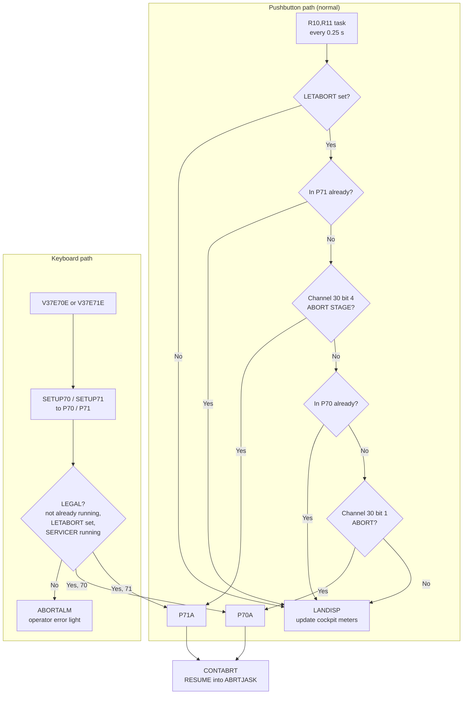
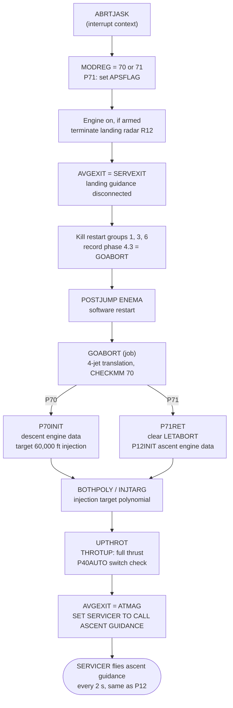

# P70 / P71: Descent Aborts

[← P68](p68.md) · [Descent overview](../README.md)

**What they do:** abandon the landing and fly back to orbit.

| Program | Button | Engine | Source |
|---|---|---|---|
| **P70** | ABORT | Descent engine (DPS), stages still together | `P70`, [P70-P71.agc:104](../../../../Luminary099/P70-P71.agc#L104) |
| **P71** | ABORT STAGE | Ascent engine (APS), descent stage left behind | `P71`, [P70-P71.agc:107](../../../../Luminary099/P70-P71.agc#L107) |

Aborts are allowed only while the flag `LETABORT` is set. `P63IGN` sets it at ignition ([BURN_BABY_BURN--MASTER_IGNITION_ROUTINE.agc:442](../../../../Luminary099/BURN_BABY_BURN--MASTER_IGNITION_ROUTINE.agc#L442)), and [P68](p68.md) clears it after landing.

## Two ways in

| Step | Source |
|---|---|
| `R10,R11` scheduled by `READACCS` 0.2 s after each accelerometer read, then re-armed every 25 cs | [SERVICER.agc:132-135](../../../../Luminary099/SERVICER.agc#L132-L135), [P70-P71.agc:36-49](../../../../Luminary099/P70-P71.agc#L36-L49) |
| `LETABORT` check, `P71NOW?`, bit 4, `P70NOW?`, bit 1 | [P70-P71.agc:72-100](../../../../Luminary099/P70-P71.agc#L72-L100) |
| Channel 30 bits are inverted ("A VALUE OF ZERO MEANS THAT THE INDICATED SIGNAL IS PRESENT") | [INPUT_OUTPUT_CHANNEL_BIT_DESCRIPTIONS.agc:143-151](../../../../Luminary099/INPUT_OUTPUT_CHANNEL_BIT_DESCRIPTIONS.agc#L143-L151) |
| Keyboard: V37 routes 70/71 to `SETUP70` / `SETUP71` | [FRESH_START_AND_RESTART.agc:748-754](../../../../Luminary099/FRESH_START_AND_RESTART.agc#L748-L754), [:1037-1047](../../../../Luminary099/FRESH_START_AND_RESTART.agc#L1037-L1047) |
| `LEGAL?` / `ABORTALM` | [P70-P71.agc:377-395](../../../../Luminary099/P70-P71.agc#L377-L395) |
| `P70A` / `P71A` / `CONTABRT` | [P70-P71.agc:105-128](../../../../Luminary099/P70-P71.agc#L105-L128) |

**ABORT STAGE wins.** Bit 4 is tested before bit 1, and before the "already in P70?" check. Pressing ABORT STAGE during a P70 abort therefore upgrades it to P71.

The buttons are **not interrupts.** `T4RUPT_PROGRAM.agc` reads channel 30 but contains no abort logic. Polling in `R10,R11` is the only path.

## The takeover

| Step | Source |
|---|---|
| `ABRTJASK` | [P70-P71.agc:133-203](../../../../Luminary099/P70-P71.agc#L133-L203) |
| `AVGEXIT = SERVEXIT` | [P70-P71.agc:177-179](../../../../Luminary099/P70-P71.agc#L177-L179), [SERVICER.agc:441-444](../../../../Luminary099/SERVICER.agc#L441-L444) |
| 4.3 phase → `GOABORT` | [P70-P71.agc:194-197](../../../../Luminary099/P70-P71.agc#L194-L197), [RESTART_TABLES.agc:185-187](../../../../Luminary099/RESTART_TABLES.agc#L185-L187) |
| `ENEMA` | [FRESH_START_AND_RESTART.agc:281](../../../../Luminary099/FRESH_START_AND_RESTART.agc#L281) |
| `GOABORT` | [P70-P71.agc:220-244](../../../../Luminary099/P70-P71.agc#L220-L244) |
| `P70INIT` | [P70-P71.agc:246-277](../../../../Luminary099/P70-P71.agc#L246-L277), `HINJECT` [:425](../../../../Luminary099/P70-P71.agc#L425) |
| `P71RET` | [P70-P71.agc:340-366](../../../../Luminary099/P70-P71.agc#L340-L366), `P12INIT` [P12.agc:179](../../../../Luminary099/P12.agc#L179) |
| `BOTHPOLY` → `UPTHROT1` | [P70-P71.agc:278-338](../../../../Luminary099/P70-P71.agc#L278-L338) |
| `ATMAG` | [ASCENT_GUIDANCE.agc:38](../../../../Luminary099/ASCENT_GUIDANCE.agc#L38) |

**Design pattern worth noticing.** The abort doesn't stop the landing code line by line. It does two things:
1. Repoints `AVGEXIT`, the same switch [P63 uses](p63.md#part-2-ignition-countdown-burnbaby-and-waitlist-tasks) to connect guidance.
2. Triggers the same **software restart** that recovers from a [1202 alarm](../event-chains.md#3-the-1202-alarm-overload-restart-recover).

The restart wipes all in-flight work, and the phase table brings back only `GOABORT` plus the SERVICER cycle (group 2 and group 5 survive).

**Inferred:**
- Entering `ABRTJASK` through `RESUME` is presumably done so it always runs in interrupt context, whichever path called it.
- The meaning of the first group-4 phase that `ABRTJASK` records (later overwritten by 4.3) was not determined.
- P70/P71 make no explicit DSKY display call; the displays come from ascent guidance.
